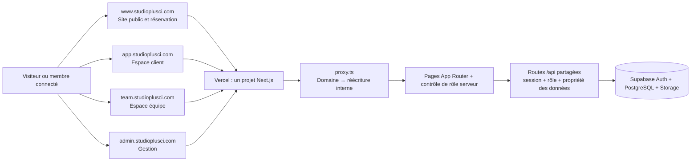

# Architecture des sous-domaines Studio+

> **Architecture de référence et état de mise en œuvre.** Le routage des quatre espaces est implémenté dans le code. Les hôtes de développement doivent être validés en Preview avant tout basculement de production.

## Décisions retenues

1. Garder un dépôt, un projet Next.js et un projet Vercel.
2. Garder les sessions isolées par sous-domaine au début. Les utilisateurs se connectent séparément sur l’espace qu’ils utilisent. Ne pas activer un cookie `Domain=.studioplusci.com` pour l’instant.
3. Garder `/reserver` canonique sur `app`. Les boutons du site public devront ouvrir `app`; les anciennes URL `www/reserver` redirigeront temporairement vers `app/reserver`.
4. Garder une connexion par espace : client sur `app`, équipe sur `team`, gestion sur `admin`. `/connexion`, récupération et callback seront servis sur ces trois domaines; `/inscription` uniquement sur `app`.
5. Le callback OAuth/e-mail reste sur le même hôte qui a lancé le flux PKCE. L’URL `next` est un chemin local validé, jamais une URL complète fournie par le navigateur.
6. Les invitations STAFF arrivent sur `team`; les invitations MANAGER sur `admin`. `ADMIN` ne peut pas être créé par le formulaire d’invitation équipe existant sans décision produit distincte.
7. L’API reste same-origin : les formulaires appellent `/api/...` depuis le même hôte et les cookies sont propres à celui-ci. Aucun CORS entre sous-domaines.
8. Hôte non prévu ou route non autorisée : 404. Route d’un espace demandée sur le mauvais sous-domaine : redirection temporaire 307 vers le domaine canonique pendant Preview, puis 308 après stabilisation. Conserver temporairement les anciennes URL sur `www`.
9. Pour le premier essai dev, conserver `dev.studioplusci.com` sur la branche Preview `dev` pour le site public et les parcours historiques. Utiliser `dev-app`, `dev-team` et `dev-admin` pour les espaces dédiés, tous rattachés à la branche Preview `dev`. Les domaines de production déjà ajoutés (`app`, `team`, `admin`) doivent rester assignés à Production. Ne pas utiliser Dynamic DNS.

### Valeurs de départ à configurer

#### Vercel → Project → Settings → Domains

Ajouter les hôtes de développement au projet `studio-plus`, avec branche Preview `dev` :

| Hôte | Branche / cible |
| --- | --- |
| `dev.studioplusci.com` | Déjà configuré : Preview, branche `dev` ; reste l’hôte historique de migration |
| `dev-app.studioplusci.com` | Preview, branche `dev` |
| `dev-team.studioplusci.com` | Preview, branche `dev` |
| `dev-admin.studioplusci.com` | Preview, branche `dev` |
| `dev-www.studioplusci.com` | Non utilisé pour le moment : le site public dev reste sur `dev.studioplusci.com` |

Créer chez le DNS autoritaire les enregistrements exactement indiqués par Vercel pour chaque domaine et attendre que Vercel indique le domaine vérifié et le certificat SSL actif. Ne pas reprendre les valeurs d’un autre projet ou inventer une cible CNAME. Les domaines sans préfixe `dev-` montrés comme Production ne doivent pas être affectés à Preview.

#### Vercel → Environment Variables → Preview (branche `dev`)

Ajouter en type Config (ces noms de domaine ne sont pas des secrets) :

```env
NEXT_PUBLIC_HOST_WWW=dev.studioplusci.com
NEXT_PUBLIC_HOST_APP=dev-app.studioplusci.com
NEXT_PUBLIC_HOST_TEAM=dev-team.studioplusci.com
NEXT_PUBLIC_HOST_ADMIN=dev-admin.studioplusci.com
```

Dans le même scope Preview, conserver toutes les clés Supabase et la base de **dev**. Ne pas recopier de variable de base ou clé secrète Supabase de Production. `APP_URL` ne peut plus représenter à lui seul les quatre origines : il faudra remplacer son usage dans les routes par une fonction d’origine canonique / hôte courant avant d’activer le routage. En attendant ce changement, ne pas prétendre que les quatre espaces sont prêts.

#### Supabase Auth → URL Configuration → projet dev

Avant que les flux soient adaptés, ne modifier que les Redirect URLs nécessaires aux essais actuels. Après implémentation des quatre hôtes, utiliser :

- **Site URL** : `https://dev-app.studioplusci.com` (fallback client, pas URL unique de tous les parcours).
- **Redirect URLs exactes** :
  - `https://dev-app.studioplusci.com/auth/callback`
  - `https://dev-team.studioplusci.com/auth/callback`
  - `https://dev-admin.studioplusci.com/auth/callback`
  - `https://dev-team.studioplusci.com/auth/accept-invite`
  - `https://dev-admin.studioplusci.com/auth/accept-invite`
  - callbacks locaux explicites, pendant les tests locaux : `http://app.localhost:3000/auth/callback`, `http://team.localhost:3000/auth/callback`, `http://admin.localhost:3000/auth/callback`.

Ne pas mettre `*.studioplusci.com`, `*.vercel.app` ou `*.localhost` comme autorisation générale. Supabase dev reste séparé de Supabase prod.

#### DNS / certificats

Le panneau **Dynamic DNS** de cPanel n’est pas le bon outil. Il sert à actualiser une IP dynamique. Pour Vercel, utiliser le gestionnaire DNS qui détient réellement les nameservers du domaine et ajouter les records fournis dans Vercel. Vérifier le certificat HTTPS de chaque hôte avant d’y configurer Supabase Auth.

#### Production — à faire après validation dev seulement

À ne pas créer ni basculer aujourd’hui. Après validation E2E, ajouter au même projet Vercel : `www.studioplusci.com`, `app.studioplusci.com`, `team.studioplusci.com`, `admin.studioplusci.com`, chacun en Production. Le domaine racine `studioplusci.com` redirige vers `www`. Les variables Production utilisent exclusivement le projet Supabase prod et les hôtes sans préfixe `dev-`. Ajouter alors les callbacks prod équivalents dans Supabase prod.

## Séquence d’implémentation dans le dépôt

Le dépôt est encore en routage par chemins : `proxy.ts` rafraîchit Supabase mais ne résout pas les hôtes. De plus, `APP_URL` est utilisé par les contrôles d’origine, les callbacks de connexion/récupération, les liens d’e-mail, les invitations et le cron. Il faut effectuer ces travaux avant d’ajouter les domaines de prod :

1. Ajouter une configuration serveur validée pour les quatre hôtes de l’environnement courant, leurs URL publiques et les rôles permis; refuser les hôtes inconnus sans faire confiance à `X-Forwarded-Host` non vérifié.
2. Ajouter une fonction pure de résolution de routes et ses tests : `app /` → `/espace`, `team /` → `/equipe`, `admin /` → `/gestion`; chemins internes sur mauvais hôte → 307 vers le bon espace; chemins inconnus → 404. Exclure correctement assets Next, API, crons et callbacks. Les crons Vercel doivent continuer à recevoir `/api/...` sur l’hôte Production assigné par Vercel et valider leur `CRON_SECRET`.
3. Modifier le proxy tout en préservant les cookies rafraîchis pour le rendu serveur. Vérifier avec la version installée de Next et `@supabase/ssr`; le code exemple de `voila.md` n’est pas à copier sans adaptation.
4. Adapter les liens du site public vers `app` pour réservation / connexion et vers les espaces appropriés. Garder `www/reserver` comme redirection transitoire, pas une deuxième réservation.
5. Adapter le formulaire de connexion au rôle et au domaine courant. Avec des sessions séparées, ne jamais connecter sur `app` puis rediriger vers `team` ou `admin`; offrir le formulaire sur chaque espace, n’accepter que les rôles de cet espace et afficher un message/lien vers le bon espace en cas de rôle incompatible. La création de compte reste réservée au client.
6. Faire pointer l’inscription et la récupération vers le callback du même hôte que le formulaire. Préserver `next` comme chemin relatif validé. Router l’acceptation d’invitation vers `team` pour STAFF et `admin` pour MANAGER.
7. Remplacer l’usage généralisé d’`APP_URL` par des URL de destinations explicites : hôte courant pour callbacks, `app` pour réservation/client, `www` pour invitation de séance, `team`/`admin` pour invitation membre, domaine correct pour les e-mails de notification. Le cron ne doit pas dériver son origine d’un domaine utilisateur.
8. Remplacer la validation des mutations par une vérification centralisée `Origin === origin de la requête` avec origines autorisées de l’environnement. Maintenir les vérifications rôle/propriété dans les routes API et pages; un layout seul n’est pas la barrière d’autorisation.
9. Ajouter `noindex` aux espaces privés et `no-referrer` aux URL à jeton; vérifier robots, analytics et absence de données personnelles/jetons dans les événements.
10. Tester en local puis sur les hôtes Preview : tous les chemins par hôte, callback PKCE, récupération, invitation STAFF/MANAGER, renouvellement de session, API same-origin, contrôle de propriété et accès refusé. Ensuite seulement configurer Production.

## Décision

Pour Studio+ la séparation en quatre sous-domaines est une bonne cible : elle rend les espaces faciles à reconnaître tout en gardant un seul projet Next.js, un dépôt et un déploiement Vercel. Les espaces peuvent partager les composants, les routes API, Supabase et Prisma.

Cette séparation reste une organisation de navigation. Elle ne constitue pas une frontière de sécurité : chaque page et route API doit continuer à vérifier la session, le rôle et la propriété des données côté serveur. Les layouts `app/equipe/layout.tsx` et `app/gestion/layout.tsx` appliquent déjà des contrôles de rôle, qui devront être conservés derrière les réécritures.

## État actuel du dépôt

Le routage par hôte est maintenant implémenté dans le dépôt sur la branche `dev`. Les domaines `dev-app`, `dev-team` et `dev-admin` desservent leurs espaces dédiés ; `dev.studioplusci.com` reste temporairement en mode historique afin de préserver les parcours existants. La production n’est pas basculée par cette implémentation. Avant un déploiement Preview, vérifier que Vercel contient la variable correctement orthographiée `NEXT_PUBLIC_HOST_WWW=dev.studioplusci.com` (le préfixe complet `NEXT_PUBLIC_` est requis), ainsi que les variables `NEXT_PUBLIC_HOST_APP`, `NEXT_PUBLIC_HOST_TEAM` et `NEXT_PUBLIC_HOST_ADMIN`.

Le projet utilise un seul déploiement Next.js pour les hôtes publics et privés. `proxy.ts` rafraîchit la session Supabase puis résout l’hôte et réécrit les URL des espaces dédiés.

| Routes actuelles | Fonction |
| --- | --- |
| `/`, `/studio`, `/tarifs`, `/projets`, `/reserver` | Site public, catalogue et demande de réservation |
| `/connexion`, `/inscription`, `/mot-de-passe-oublie`, `/nouveau-mot-de-passe`, `/auth/callback` | Accès et récupération de compte |
| `/espace`, `/espace/parametres`, `/espace/projets/:id` | Espace client |
| `/equipe`, `/equipe/seances`, `/equipe/seances/:id`, `/equipe/projets/:id`, `/equipe/parametres` | Espace équipe |
| `/gestion`, `/gestion/reservations`, `/gestion/statistiques`, `/gestion/emails`, `/gestion/utilisateurs`, `/gestion/reglages`, `/gestion/projets/:id` | Gestion du studio |
| `/invite/:token`, `/auth/accept-invite` | Réponse d’un invité et activation d’une invitation d’équipe |
| `/api/*` | API partagée par les différents espaces |

## Cible de routage

Les routes de gauche sont celles que la personne verra dans son navigateur. Les routes de droite sont les pages internes actuelles vers lesquelles le proxy Next.js réécrirait la requête, sans changer l’URL affichée.

| Hôte | URL visible | Route interne Next.js | Accès attendu |
| --- | --- | --- | --- |
| `www.studioplusci.com` | `/`, `/studio`, `/tarifs`, `/projets`, `/reserver` | même chemin | Public ; création d’une réservation par un compte client connecté |
| `www.studioplusci.com` | `/invite/:token` | même chemin | Invité muni du lien valide |
| `app.studioplusci.com` | `/` | `/espace` | `CLIENT` |
| `app.studioplusci.com` | `/connexion`, `/inscription`, `/mot-de-passe-oublie`, `/nouveau-mot-de-passe`, `/auth/callback` | même chemin | Authentification client |
| `app.studioplusci.com` | `/reserver` | `/reserver` | Client connecté ; le visiteur peut être dirigé vers la connexion |
| `app.studioplusci.com` | `/parametres`, `/projets/:id` | `/espace/parametres`, `/espace/projets/:id` | `CLIENT`, propriétaire de la réservation/projet |
| `team.studioplusci.com` | `/` | `/equipe` | `STAFF`, `MANAGER`, `ADMIN` |
| `team.studioplusci.com` | `/seances`, `/seances/:id`, `/projets/:id`, `/parametres` | `/equipe/seances`, `/equipe/seances/:id`, `/equipe/projets/:id`, `/equipe/parametres` | `STAFF` affecté ; accès élargi aux responsables autorisés |
| `team.studioplusci.com` | `/auth/accept-invite` | même chemin | Activation d’une invitation d’équipe valide |
| `admin.studioplusci.com` | `/` | `/gestion` | `MANAGER`, `ADMIN` |
| `admin.studioplusci.com` | `/reservations`, `/statistiques`, `/emails`, `/projets/:id` | routes correspondantes sous `/gestion` | `MANAGER`, `ADMIN` |
| `admin.studioplusci.com` | `/utilisateurs`, `/reglages` | `/gestion/utilisateurs`, `/gestion/reglages` | `ADMIN` uniquement |

La page publique de connexion peut proposer plusieurs accès, mais après authentification chaque rôle doit être envoyé vers son espace : `CLIENT` → `app`, `STAFF` → `team`, `MANAGER`/`ADMIN` → `admin`. Le comportement actuel de `ROLE_HOME` renvoie des chemins internes (`/espace`, `/equipe`, `/gestion`) ; il faudra le faire évoluer pour générer des destinations absolues valides ou des chemins adaptés à l’hôte.

Les navigations entre hôtes doivent être explicites : l’espace équipe ouvre l’administration sur `admin.studioplusci.com`, et le site public ouvre l’espace client sur `app.studioplusci.com`. Une requête directe à une route d’un autre espace sur le mauvais hôte doit être redirigée vers l’hôte canonique ou renvoyer une page 404, sans contourner les contrôles d’accès.

## Schéma



## Adaptations techniques indispensables

### 1. Routage par hôte

Ajouter à `proxy.ts` une table explicite des hôtes autorisés par environnement, puis réécrire les URL publiques vers les routes internes. Ne pas faire confiance à un nom de domaine arbitraire fourni dans `Host` ou `X-Forwarded-Host` : comparer à une liste fixe de domaines attendus. Prévoir les domaines Preview de façon contrôlée, sans accepter `*.vercel.app` indistinctement.

Le proxy doit aussi définir le comportement pour les chemins inconnus, éviter les boucles de réécriture et exclure correctement les ressources Next.js et les API. Les API restent communes ; le proxy ne remplace aucune autorisation.

### 2. Origines des mutations et sécurité API

Plusieurs routes comparent actuellement l’en-tête `Origin` à la seule valeur `APP_URL`. Une fois les espaces déplacés sur des hôtes distincts, ces appels seront rejetés. Remplacer cette comparaison par une validation centralisée des origines Studio+ autorisées selon l’environnement, tout en conservant une protection CSRF stricte et les contrôles de rôle/propriété. Ne pas accepter toute origine simplement parce qu’elle partage le suffixe `studioplusci.com`.

### 3. Authentification, e-mails et redirections

Le code construit actuellement plusieurs liens avec `APP_URL`, et la création de compte fixe le callback sur cet hôte. Il faudra choisir les hôtes canoniques de chaque parcours et générer leurs URL depuis une configuration serveur contrôlée :

- confirmation, connexion et récupération client → `app` ;
- acceptation d’invitation d’équipe → `team` ;
- invitations d’administrateurs/managers → `admin` ou `team` selon le rôle ;
- invitations d’invités de séance → `www`.

Ajouter les URL de callback correspondantes à la liste autorisée Supabase Auth, dans dev et prod séparément. Les paramètres de retour (`next`) doivent rester des chemins relatifs ou des destinations issues d’une liste d’hôtes connue ; jamais une redirection ouverte vers une URL fournie par l’utilisateur.

### 4. Cookies et sessions partagées

Par défaut, les cookies d’authentification sont propres à l’hôte. Une connexion sur `app` ne garantit donc pas automatiquement une session sur `team` et `admin`. Deux choix sont possibles :

- **Sessions propres à chaque sous-domaine (recommandé au départ)** : chaque espace se reconnecte séparément. C’est plus simple à sécuriser et limite la portée des cookies.
- **Session commune aux sous-domaines** : configurer explicitement le domaine de cookie `.studioplusci.com`, puis vérifier les attributs `Secure`, `HttpOnly`, `SameSite`, le renouvellement et les risques liés au partage entre sous-domaines. Ne choisir cette option que si l’expérience produit exige réellement un SSO transparent.

Le routage par hôte seul ne donne pas le SSO.

### 5. Liens internes, API et observabilité

Mettre à jour les liens `Link`, les redirections par rôle, les URL des e-mails, les liens vers projets et les chemins `return_to`. L’API `/api/*` peut être appelée depuis les différents sous-domaines si les cookies et contrôles d’origine sont configurés pour le choix de session retenu.

Pour Vercel Analytics, les quatre hôtes apparaîtront comme des domaines distincts. Garder la normalisation des liens d’invitation afin de ne jamais envoyer leur jeton aux analytics. Ne pas inclure d’e-mail, de nom, de téléphone, d’identifiant de réservation ou de projet dans les événements personnalisés.

## Configuration Vercel et DNS

Ajouter `www.studioplusci.com`, `app.studioplusci.com`, `team.studioplusci.com` et `admin.studioplusci.com` au même projet Vercel. Vercel doit associer les domaines de prod à l’environnement Production, et les domaines dev/staging à Preview avec leur branche dédiée. Chaque entrée DNS doit suivre la cible exacte affichée par Vercel ; le routage HTTP est ensuite fait par Next.js, pas par Dynamic DNS.

Les variables de Preview doivent pointer uniquement vers Supabase dev. Production doit pointer uniquement vers Supabase prod. Prévoir des URL canoniques par espace, plutôt que d’utiliser une seule `APP_URL` pour tous les e-mails et redirections.

## Ordre de mise en œuvre

1. Confirmer les URL canoniques et décider si les sessions seront séparées ou partagées.
2. Implémenter les réécritures d’hôte dans `proxy.ts`, avec une table testable des hôtes et chemins.
3. Centraliser la validation des origines et des URL de destination d’authentification.
4. Mettre à jour les liens internes, les callbacks Supabase et les liens des e-mails.
5. Ajouter les domaines DNS/Vercel, d’abord sur Preview avec Supabase dev.
6. Vérifier chaque hôte, rôle, redirection, API, lien d’invitation, fichier privé et refus d’accès sur Preview.
7. Après validation, configurer les domaines et variables Production avec Supabase prod.

## Critères de validation

- Chaque URL canonique ouvre le bon espace et garde son hôte dans la barre d’adresse.
- Un `CLIENT` ne peut pas ouvrir `/equipe` ou `/gestion`, même en saisissant l’URL directement.
- Un `STAFF` ne peut consulter que les séances affectées et ne peut pas ouvrir la gestion globale.
- Un `MANAGER` ne peut pas ouvrir les fonctions réservées à `ADMIN`.
- Les mêmes restrictions s’appliquent aux routes API, y compris avec un ID appartenant à un autre utilisateur.
- Connexion, inscription, confirmation, récupération, déconnexion et invitations reviennent sur le bon sous-domaine.
- Les cookies se comportent selon le choix documenté (sessions séparées ou SSO).
- Les liens Preview utilisent uniquement Supabase dev et les liens Production uniquement Supabase prod.
- Les invitations d’invités et leurs jetons ne sont pas divulgués à Vercel Analytics.
