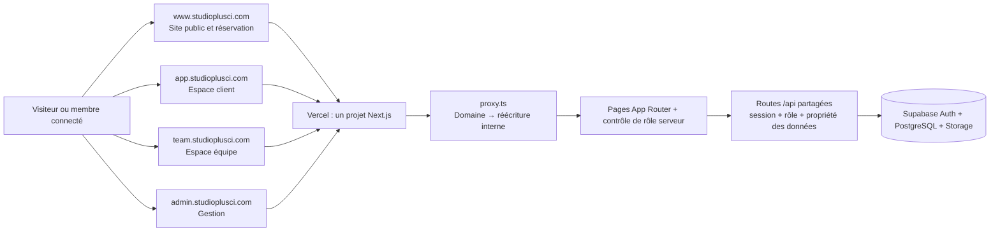

# Architecture des sous-domaines Studio+

## Décision

Pour Studio+ la séparation en quatre sous-domaines est une bonne cible : elle rend les espaces faciles à reconnaître tout en gardant un seul projet Next.js, un dépôt et un déploiement Vercel. Les espaces peuvent partager les composants, les routes API, Supabase et Prisma.

Cette séparation reste une organisation de navigation. Elle ne constitue pas une frontière de sécurité : chaque page et route API doit continuer à vérifier la session, le rôle et la propriété des données côté serveur. Les layouts `app/equipe/layout.tsx` et `app/gestion/layout.tsx` appliquent déjà des contrôles de rôle, qui devront être conservés derrière les réécritures.

## État actuel du dépôt

Le projet sert actuellement toutes ses pages sur un même hôte et sépare les espaces par chemin. `proxy.ts` rafraîchit la session Supabase, mais ne détecte pas le domaine et ne réécrit pas les URL.

| Routes actuelles | Fonction |
| --- | --- |
| `/`, `/studio`, `/tarifs`, `/projets`, `/reserver` | Site public, catalogue et demande de réservation |
| `/connexion`, `/inscription`, `/mot-de-passe-oublie`, `/nouveau-mot-de-passe`, `/auth/callback` | Accès et récupération de compte |
| `/espace`, `/espace/parametres`, `/espace/projets/:id` | Espace client |
| `/equipe`, `/equipe/seances`, `/equipe/seances/:id`, `/equipe/projets/:id`, `/equipe/parametres` | Espace équipe |
| `/gestion`, `/gestion/reservations`, `/gestion/statistiques`, `/gestion/emails`, `/gestion/utilisateurs`, `/gestion/reglages`, `/gestion/projets/:id` | Gestion du studio |
| `/invite/:token`, `/auth/accept-invite` | Réponse d’un invité et activation d’une invitation d’équipe |
| `/api/*` | API partagée par les différents espaces |

## Cible de routage

Les routes de gauche sont celles que la personne verra dans son navigateur. Les routes de droite sont les pages internes actuelles vers lesquelles le proxy Next.js réécrirait la requête, sans changer l’URL affichée.

| Hôte | URL visible | Route interne Next.js | Accès attendu |
| --- | --- | --- | --- |
| `www.studioplusci.com` | `/`, `/studio`, `/tarifs`, `/projets`, `/reserver` | même chemin | Public ; création d’une réservation par un compte client connecté |
| `www.studioplusci.com` | `/invite/:token` | même chemin | Invité muni du lien valide |
| `app.studioplusci.com` | `/` | `/espace` | `CLIENT` |
| `app.studioplusci.com` | `/connexion`, `/inscription`, `/mot-de-passe-oublie`, `/nouveau-mot-de-passe`, `/auth/callback` | même chemin | Authentification client |
| `app.studioplusci.com` | `/reserver` | `/reserver` | Client connecté ; le visiteur peut être dirigé vers la connexion |
| `app.studioplusci.com` | `/parametres`, `/projets/:id` | `/espace/parametres`, `/espace/projets/:id` | `CLIENT`, propriétaire de la réservation/projet |
| `team.studioplusci.com` | `/` | `/equipe` | `STAFF`, `MANAGER`, `ADMIN` |
| `team.studioplusci.com` | `/seances`, `/seances/:id`, `/projets/:id`, `/parametres` | `/equipe/seances`, `/equipe/seances/:id`, `/equipe/projets/:id`, `/equipe/parametres` | `STAFF` affecté ; accès élargi aux responsables autorisés |
| `team.studioplusci.com` | `/auth/accept-invite` | même chemin | Activation d’une invitation d’équipe valide |
| `admin.studioplusci.com` | `/` | `/gestion` | `MANAGER`, `ADMIN` |
| `admin.studioplusci.com` | `/reservations`, `/statistiques`, `/emails`, `/projets/:id` | routes correspondantes sous `/gestion` | `MANAGER`, `ADMIN` |
| `admin.studioplusci.com` | `/utilisateurs`, `/reglages` | `/gestion/utilisateurs`, `/gestion/reglages` | `ADMIN` uniquement |

La page publique de connexion peut proposer plusieurs accès, mais après authentification chaque rôle doit être envoyé vers son espace : `CLIENT` → `app`, `STAFF` → `team`, `MANAGER`/`ADMIN` → `admin`. Le comportement actuel de `ROLE_HOME` renvoie des chemins internes (`/espace`, `/equipe`, `/gestion`) ; il faudra le faire évoluer pour générer des destinations absolues valides ou des chemins adaptés à l’hôte.

Les navigations entre hôtes doivent être explicites : l’espace équipe ouvre l’administration sur `admin.studioplusci.com`, et le site public ouvre l’espace client sur `app.studioplusci.com`. Une requête directe à une route d’un autre espace sur le mauvais hôte doit être redirigée vers l’hôte canonique ou renvoyer une page 404, sans contourner les contrôles d’accès.

## Schéma

## Adaptations techniques indispensables

### 1. Routage par hôte

Ajouter à `proxy.ts` une table explicite des hôtes autorisés par environnement, puis réécrire les URL publiques vers les routes internes. Ne pas faire confiance à un nom de domaine arbitraire fourni dans `Host` ou `X-Forwarded-Host` : comparer à une liste fixe de domaines attendus. Prévoir les domaines Preview de façon contrôlée, sans accepter `*.vercel.app` indistinctement.

Le proxy doit aussi définir le comportement pour les chemins inconnus, éviter les boucles de réécriture et exclure correctement les ressources Next.js et les API. Les API restent communes ; le proxy ne remplace aucune autorisation.

### 2. Origines des mutations et sécurité API

Plusieurs routes comparent actuellement l’en-tête `Origin` à la seule valeur `APP_URL`. Une fois les espaces déplacés sur des hôtes distincts, ces appels seront rejetés. Remplacer cette comparaison par une validation centralisée des origines Studio+ autorisées selon l’environnement, tout en conservant une protection CSRF stricte et les contrôles de rôle/propriété. Ne pas accepter toute origine simplement parce qu’elle partage le suffixe `studioplusci.com`.

### 3. Authentification, e-mails et redirections

Le code construit actuellement plusieurs liens avec `APP_URL`, et la création de compte fixe le callback sur cet hôte. Il faudra choisir les hôtes canoniques de chaque parcours et générer leurs URL depuis une configuration serveur contrôlée :

- confirmation, connexion et récupération client → `app` ;
- acceptation d’invitation d’équipe → `team` ;
- invitations d’administrateurs/managers → `admin` ou `team` selon le rôle ;
- invitations d’invités de séance → `www`.

Ajouter les URL de callback correspondantes à la liste autorisée Supabase Auth, dans dev et prod séparément. Les paramètres de retour (`next`) doivent rester des chemins relatifs ou des destinations issues d’une liste d’hôtes connue ; jamais une redirection ouverte vers une URL fournie par l’utilisateur.

### 4. Cookies et sessions partagées

Par défaut, les cookies d’authentification sont propres à l’hôte. Une connexion sur `app` ne garantit donc pas automatiquement une session sur `team` et `admin`. Deux choix sont possibles :

- **Sessions propres à chaque sous-domaine (recommandé au départ)** : chaque espace se reconnecte séparément. C’est plus simple à sécuriser et limite la portée des cookies.
- **Session commune aux sous-domaines** : configurer explicitement le domaine de cookie `.studioplusci.com`, puis vérifier les attributs `Secure`, `HttpOnly`, `SameSite`, le renouvellement et les risques liés au partage entre sous-domaines. Ne choisir cette option que si l’expérience produit exige réellement un SSO transparent.

Le routage par hôte seul ne donne pas le SSO.

### 5. Liens internes, API et observabilité

Mettre à jour les liens `Link`, les redirections par rôle, les URL des e-mails, les liens vers projets et les chemins `return_to`. L’API `/api/*` peut être appelée depuis les différents sous-domaines si les cookies et contrôles d’origine sont configurés pour le choix de session retenu.

Pour Vercel Analytics, les quatre hôtes apparaîtront comme des domaines distincts. Garder la normalisation des liens d’invitation afin de ne jamais envoyer leur jeton aux analytics. Ne pas inclure d’e-mail, de nom, de téléphone, d’identifiant de réservation ou de projet dans les événements personnalisés.

## Configuration Vercel et DNS

Ajouter `www.studioplusci.com`, `app.studioplusci.com`, `team.studioplusci.com` et `admin.studioplusci.com` au même projet Vercel. Vercel doit associer les domaines de prod à l’environnement Production, et les domaines dev/staging à Preview avec leur branche dédiée. Chaque entrée DNS doit suivre la cible exacte affichée par Vercel ; le routage HTTP est ensuite fait par Next.js, pas par Dynamic DNS.

Les variables de Preview doivent pointer uniquement vers Supabase dev. Production doit pointer uniquement vers Supabase prod. Prévoir des URL canoniques par espace, plutôt que d’utiliser une seule `APP_URL` pour tous les e-mails et redirections.

## Ordre de mise en œuvre

1. Confirmer les URL canoniques et décider si les sessions seront séparées ou partagées.
2. Implémenter les réécritures d’hôte dans `proxy.ts`, avec une table testable des hôtes et chemins.
3. Centraliser la validation des origines et des URL de destination d’authentification.
4. Mettre à jour les liens internes, les callbacks Supabase et les liens des e-mails.
5. Ajouter les domaines DNS/Vercel, d’abord sur Preview avec Supabase dev.
6. Vérifier chaque hôte, rôle, redirection, API, lien d’invitation, fichier privé et refus d’accès sur Preview.
7. Après validation, configurer les domaines et variables Production avec Supabase prod.

## Critères de validation

- Chaque URL canonique ouvre le bon espace et garde son hôte dans la barre d’adresse.
- Un `CLIENT` ne peut pas ouvrir `/equipe` ou `/gestion`, même en saisissant l’URL directement.
- Un `STAFF` ne peut consulter que les séances affectées et ne peut pas ouvrir la gestion globale.
- Un `MANAGER` ne peut pas ouvrir les fonctions réservées à `ADMIN`.
- Les mêmes restrictions s’appliquent aux routes API, y compris avec un ID appartenant à un autre utilisateur.
- Connexion, inscription, confirmation, récupération, déconnexion et invitations reviennent sur le bon sous-domaine.
- Les cookies se comportent selon le choix documenté (sessions séparées ou SSO).
- Les liens Preview utilisent uniquement Supabase dev et les liens Production uniquement Supabase prod.
- Les invitations d’invités et leurs jetons ne sont pas divulgués à Vercel Analytics.
