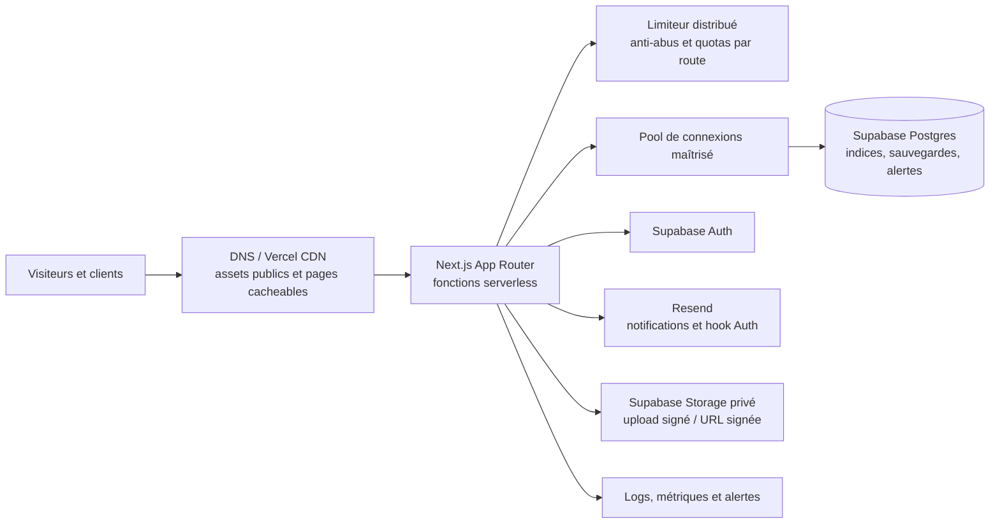

# Capacité et montée en charge Studio+

## Objectif

Préparer Studio+ à accueillir jusqu’à **10 000 inscriptions par mois** et **100 000 visites par mois**, sans supposer qu’une moyenne mensuelle garantit le comportement aux heures de pointe.

Ce document est un plan d’ingénierie et d’exploitation, pas une garantie de capacité. Le nombre réel de pages vues, le taux de simultanéité, les médias transférés, la répartition géographique et les quotas des plans choisis déterminent la capacité et le coût. Les limites et tarifs des fournisseurs évoluent : les vérifier dans leurs tableaux de bord avant une mise en production à ce niveau.

## Comment interpréter la cible

Il faut distinguer :

- **visites** : sessions ou visiteurs mensuels, à préciser dans Analytics ;
- **pages vues** : nombre de pages chargées ;
- **inscriptions réussies** : comptes créés, hors tentatives échouées et bots ;
- **pics** : connexions et requêtes simultanées pendant une campagne, une publication ou un envoi d’e-mail.

Si 100 000 signifie des visites par mois, cela représente environ 3 300 visites par jour en moyenne ; 10 000 inscriptions par mois représentent environ 330 créations par jour. Ces moyennes restent faibles par rapport aux capacités annoncées des fonctions serverless, mais elles ne dimensionnent ni Supabase, ni les e-mails, ni un pic de lancement. Il faut mesurer les pics réels et tester une marge au-dessus de ceux-ci.

## État actuel du projet

| Zone | État constaté | Conséquence à traiter |
| --- | --- | --- |
| Web | Next.js App Router déployé sur Vercel ; médias publics principalement dans `public/` ; Analytics Vercel intégré | Mesurer les pages lentes, le volume d’images et les requêtes par parcours |
| PostgreSQL | Supabase ; Prisma avec `PrismaPg` ; `DATABASE_URL` utilise le pooler de transaction en runtime, `DIRECT_URL` sert aux migrations | Le pooler est adapté aux fonctions serverless ; dimensionner le pool applicatif et le compute avec des mesures |
| Requêtes de réservation | Transaction sérialisable et unicité de créneaux, indices de base présents | Garder cette protection de concurrence et tester les réservations simultanées |
| Listes | Les réservations manager sont paginées ; la route partagée demande jusqu’à 500 réservations par défaut aux autres rôles | Réduire les réponses aux champs utiles et paginer ou limiter aux séances pertinentes |
| Prestations | `/api/services` lit les réglages en base et renvoie `no-store` | Mettre en cache cette donnée publique avec invalidation lors d’une modification des réglages |
| Disponibilités | `/api/availability` relit la configuration et les créneaux à chaque date, avec `no-store` | Conserver la fraîcheur nécessaire, mesurer le coût DB et mettre en cache la configuration courte durée |
| Protection contre l’abus | Les formulaires ont des validations ; aucune limitation de débit applicative partagée n’a été repérée | Ajouter une limitation distribuée pour inscription, récupération, booking, invitations et uploads |
| E-mails | Resend est appelé par le serveur ; le hook Supabase envoie aussi directement via l’application | Suivre quotas, erreurs et latence ; mettre en file les notifications métier si les pics ou retards le justifient |
| Fichiers privés | Supabase Storage privé, 25 Mo par fichier | Les transferts doivent rester directs vers Storage avec autorisation temporaire, pas transiter dans une Function |
| Tâches planifiées | Deux Cron Vercel journaliers | Suffisant pour le keepalive et l’expiration actuelle ; vérifier le lot maximal et les retards de traitement |

## Architecture cible à ce volume

Il n’est pas nécessaire d’ajouter immédiatement une architecture microservices, un cluster Kubernetes ou un système de files complexe pour cette cible. Il faut d’abord réduire les lectures inutiles, protéger les endpoints contre les abus, vérifier les limites des services et mesurer les pics. Une file de travaux devient utile si les e-mails ou tâches longues ralentissent les demandes web, ou si les lots dépassent les délais des fonctions.

## Travaux nécessaires avant d’ouvrir ce volume

### 1. Mesurer le trafic et poser des seuils

Définir des objectifs de service avant de choisir les plans : disponibilité cible, temps de réponse p95 des parcours publics et privés, taux d’erreur admissible, délai maximal de réception d’un e-mail, RPO (perte de données maximale acceptable) et RTO (délai de reprise acceptable).

Suivre au minimum : visites et pages vues, inscriptions commencées/réussies, réservations, latence p50/p95/p99, taux de réponses 4xx/5xx/429, temps des requêtes PostgreSQL, connexions actives/attente, CPU et stockage DB, egress, stockage fichiers, e-mails envoyés/échoués et durée des Cron. Ne pas envoyer de données personnelles ou d’identifiants individuels à Analytics.

### 2. Protéger les endpoints publics

Ajouter un limiteur **distribué et partagé** entre les instances Vercel ; une variable en mémoire d’une Function ne protège pas l’application à l’échelle horizontale. Définir des seuils distincts par action pour :

- inscription, connexion et récupération de mot de passe ;
- demandes de réservation et vérification de disponibilité ;
- envoi et réponse aux invitations ;
- création d’URL de téléversement ;
- endpoints coûteux ou qui déclenchent des e-mails.

Utiliser les protections Auth de Supabase en complément, surveiller les `429` et ajouter un challenge anti-bot aux formulaires si le trafic le justifie. Les limites Auth par défaut peuvent être trop basses pour les e-mails de confirmation d’une campagne ; relever un quota seulement après vérification de Resend, de la réputation du domaine et des contrôles anti-abus. La documentation Supabase décrit les limites Auth et la transmission d’adresse IP derrière un proxy.

### 3. Maîtriser PostgreSQL et les connexions

- Conserver le pooler de transaction Supabase pour le runtime serverless ; réserver la connexion directe/session pour migrations ou outils qui nécessitent une session persistante.
- Régler le nombre maximal de connexions du pool côté `pg`/adapter à une petite valeur mesurée par instance. Le total potentiel dépend du nombre d’instances Vercel, et non du seul nombre de lignes Prisma.
- Surveiller connexions, attente, verrous, requêtes lentes et saturation ; augmenter compute/pooler selon les métriques, pas sur la base du seul nombre d’inscriptions.
- Garder les transactions courtes ; ne pas appeler Resend ou Storage à l’intérieur d’une transaction DB.
- Vérifier les plans d’exécution et indices sur les listes, recherches de gestion, disponibilité et pages projet avec des données de taille réaliste.
- Remplacer le chargement générique de jusqu’à 500 réservations pour un compte par des fenêtres pertinentes (à venir / historique) et pagination avec sélection de colonnes.
- Garder les listes de gestion paginées et plafonner les tailles de page ; ne pas accepter des limites arbitraires venant du client.
- Mettre les données de catalogue et de configuration peu changeantes en cache, puis invalider le cache après une modification. Ne pas mettre en cache les données privées de client, les réservations ou les droits.
- Prévoir une politique de conservation/archivage pour les livraisons d’e-mail et journaux qui croissent continuellement.

Supabase recommande un pooler pour les environnements serverless et indique que les pools applicatifs par instance doivent être dimensionnés prudemment. Le pooler de transaction partage une connexion Postgres entre les clients et a des limites propres ; surveiller les connexions de la base et les attentes.

### 4. Distinguer les caches publics et les données privées

Les images, polices, vidéos et pages marketing publiques doivent profiter du CDN et des en-têtes de cache. Les API de réservation et de disponibilité restent fraîches, mais peuvent réutiliser une configuration courte durée. Toutes les réponses qui contiennent profil, e-mail, téléphone, réservation, invitation ou livrable doivent rester privées et non partageables entre utilisateurs.

Les fichiers privés doivent être téléversés directement dans Supabase Storage avec un jeton signé après vérification d’accès ; les téléchargements passent par une URL signée de courte durée. Éviter de charger les octets de fichiers dans les fonctions Vercel.

### 5. Fiabiliser e-mails et tâches asynchrones

Mesurer les quotas et limites d’envoi Resend, configurer alertes de rebond/échec et vérifier SPF, DKIM et DMARC. Tester le volume réel d’e-mails attendu : 10 000 inscriptions ne signifient pas seulement 10 000 messages, car confirmations, récupération, réservations, invitations et factures s’y ajoutent.

Pour les notifications métier, une file durable avec reprises, idempotence et backoff pourra séparer la réponse HTTP de la livraison e-mail si la latence ou les pics l’exigent. Ne jamais rejouer automatiquement un lien d’invitation ou un jeton expirant. Pour Supabase Auth, respecter le contrat du hook d’envoi : répondre dans le délai prévu et rendre l’échec visible ; ne pas accepter l’événement si l’e-mail n’a pas été pris en charge.

Les traitements Cron doivent être idempotents, limités par lots, reprendre après échec et exposer le nombre d’éléments en attente. Pour des volumes dépassant les délais d’une Function, découper les lots et stocker l’avancement plutôt que traiter toute la table en une invocation.

### 6. Sauvegarde, sécurité et reprise

- Choisir un plan Supabase adapté à la production, avec sauvegardes et restauration cohérentes avec les objectifs RPO/RTO ; tester une restauration sur un environnement isolé.
- Garder dev, Preview et prod séparés ; ne jamais brancher une Preview sur les données prod.
- Garder les clés secrètes côté serveur, limiter les accès dashboard et faire tourner les secrets selon un processus documenté.
- Vérifier RLS, autorisations côté serveur et contrôle de propriété sur chaque lecture ou mutation, même lorsque Prisma utilise un rôle de base privilégié.
- Prévoir des alertes de facture/quota pour éviter pause, dépassement de stockage ou dépassement de budget inattendus.
- Maintenir un plan de retour arrière pour l’application et des migrations DB compatibles avec la version précédente (approche expand/contract pour les changements risqués).

## Plan de montée en charge par paliers

### Palier A — avant lancement Preview/production

- Centraliser le rate limiting distribué et appliquer les premières limites aux routes sensibles.
- Réduire le chargement de réservations à 500 pour les vues client/staff ; sélectionner les champs nécessaires.
- Mettre en cache les prestations et la configuration publique avec invalidation.
- Ajouter métriques, alertes, suivi des e-mails et tableaux de bord DB.
- Vérifier le plan Vercel/Supabase/Resend et les quotas actuels dans les consoles.
- Charger un jeu de données synthétique proche de 12 mois d’activité pour évaluer les requêtes et indices.

### Palier B — pré-lancement du trafic cible

- Lancer des tests de charge sur Preview avec une base séparée et des comptes/données synthétiques.
- Tester les parcours lecture publique, disponibilité, inscription, connexion, réservation concurrente, espace client, listes gestion, téléversement et hook e-mail.
- Utiliser un scénario de montée progressive puis des pointes au moins 5× le pic attendu, et un test d’endurance ; ajuster ce multiplicateur d’après les campagnes réelles.
- Confirmer que le stock de connexions DB, les délais de fonction, les quotas e-mail et l’egress restent sous les seuils définis.
- Ne jamais exécuter un test de charge contre Supabase prod ou envoyer des milliers de vrais e-mails sans campagne explicitement planifiée.

### Palier C — exploitation

- Observer les premières campagnes et revoir les métriques après chaque pic.
- Augmenter compute DB ou pooler uniquement si latence, connexions ou CPU démontrent le besoin.
- Ajouter une file de travaux et déporter les tâches lentes si le temps de réponse web ou les délais de Function deviennent problématiques.
- Réévaluer quotas, coûts et sauvegardes chaque mois et après une campagne.

## Critères de capacité avant annonce publique

La cible est considérée prête quand un test de charge représentatif, sur Preview isolée, montre :

- les parcours inscription et réservation terminent sans perte de compte ni double attribution de créneau ;
- les objectifs de latence p95/p99 et d’erreurs définis par Studio+ sont tenus pendant la charge et les pointes ;
- aucune saturation de connexions Postgres, de pool Supavisor, de disque, d’egress ou de durée de Function ;
- les e-mails Auth et métier sont délivrés ou mis en reprise avec un état visible ;
- les limites anti-abus protègent les routes sensibles sans bloquer le trafic légitime de test ;
- la restauration de sauvegarde et le retour arrière de l’application ont été exercés ;
- le budget mensuel prévu inclut compute Supabase, egress, stockage, Vercel, Resend et éventuel service de rate limiting.

## Références fournisseurs

- [Connexion PostgreSQL et choix du pooler Supabase](https://supabase.com/docs/guides/database/connecting-to-postgres)
- [Gestion des connexions Supabase](https://supabase.com/docs/guides/database/connection-management)
- [Limites Auth et protection contre l’abus](https://supabase.com/docs/guides/auth/rate-limits)
- [Quotas et facturation Supabase](https://supabase.com/docs/guides/platform/billing-on-supabase)
- [Limites des Vercel Functions](https://vercel.com/docs/functions/limitations)
- [Mise à l’échelle de la concurrence Vercel](https://vercel.com/docs/functions/concurrency-scaling)
