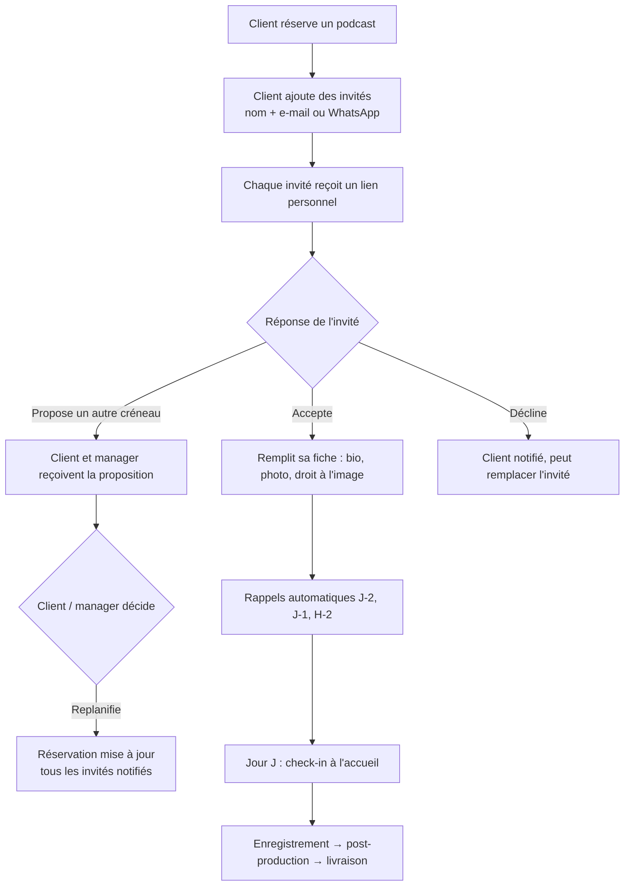
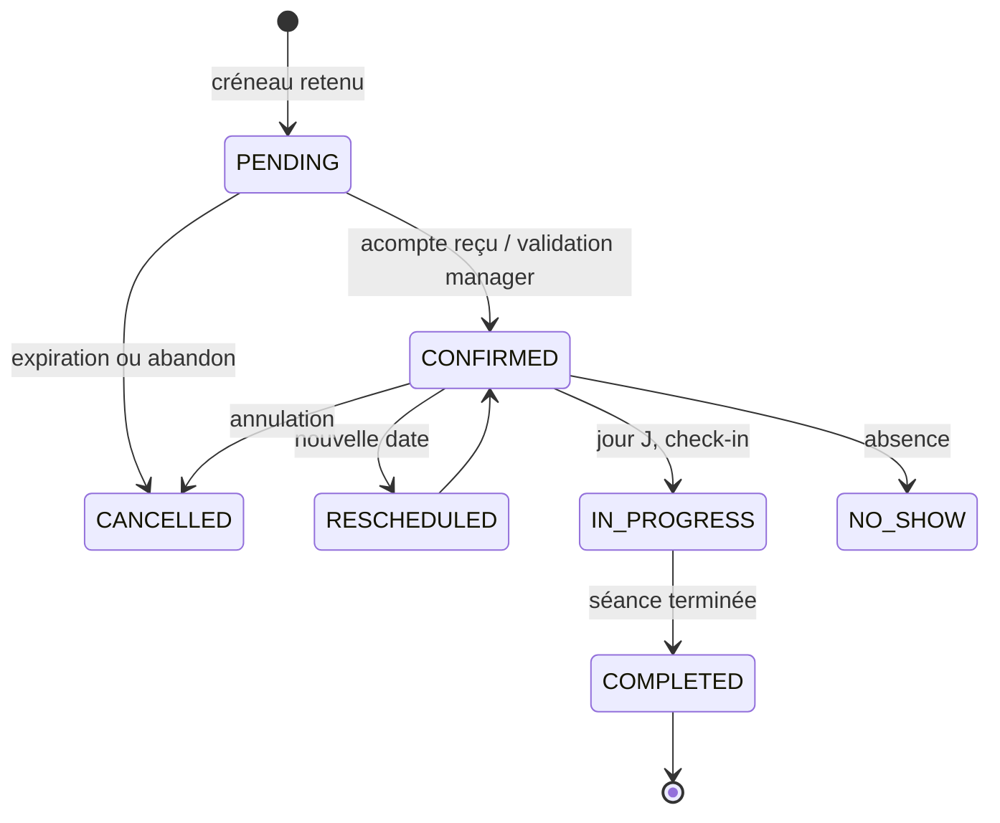

# STUDIO PLUS : Plateforme de réservation et de gestion

> **Document de départ** (cahier des charges + architecture + prompts).
> À déposer dans le nouveau projet, puis à découper phase par phase.
> Version 0.1, novembre 2026. Les éléments marqués ⚠️ sont à valider avec l'équipe Studio Plus.

---

## 0. Comment utiliser ce document

1. Lire la **section 13** (priorisation) pour décider quoi construire en premier et quoi retirer.
2. Donner à l'assistant de code la **section 15 (prompt maître)**, puis les **prompts de phase**.
3. Les sections 2 à 12 servent de référence : l'assistant doit les relire avant chaque phase.
4. Rien ici n'est figé. Les "questions ouvertes" (section 14) doivent être tranchées avant la Phase 2.

---

## 1. Vision et périmètre

### 1.1 Contexte
**Studio Plus** (« Votre partenaire créatif ») est un studio audiovisuel basé à **Abidjan, Cocody Angré Nouveau CHU**. Services actuels : **shooting photo**, **vidéo**, **podcast** (studio + captation), avec des catalogues « Shooting » et « Podcast ». Ouvert **lundi–samedi, 08h30–20h00** ⚠️. Site actuel : `www.studioplusci.com`.

### 1.2 Problème à résoudre
- Les réservations, les invitations d'intervenants et le suivi de production passent par des canaux dispersés (appels, WhatsApp, fichiers).
- Les clients ne savent pas où en est leur projet.
- L'équipe n'a pas de vue unique du planning, de la charge de travail ni des chiffres.

### 1.3 Objectifs
| # | Objectif | Indicateur de réussite |
|---|----------|------------------------|
| 1 | Le client réserve seul, en moins de 3 minutes, sur mobile | Taux de finalisation du tunnel > 60 % |
| 2 | Plus aucun double-booking | 0 conflit de salle ou d'équipe |
| 3 | Les invités d'un podcast sont invités et confirment sans créer de compte | > 80 % de confirmations avant J-1 |
| 4 | L'équipe suit chaque projet de la demande à la livraison | 100 % des projets avec un statut à jour |
| 5 | La direction pilote avec des chiffres fiables | Tableau de bord utilisé chaque semaine |

### 1.4 Les 3 espaces de l'application
1. **Espace Client (page pilote)** : réserver, suivre, récupérer ses livrables, inviter ses intervenants.
2. **Espace Équipe (« le fil »)** : agenda personnel, tâches, pipeline de production.
3. **Back-office Direction / Gestion** : planning global, catalogue, équipe, facturation, **statistiques et aide à la décision** (priorité : le studio podcast).

Plus un **lien public d'invitation** pour les intervenants externes (invités de podcast), sans compte.

### 1.5 Hors périmètre (V1)
Application mobile native, paiement en ligne automatisé, synchronisation Google Calendar bidirectionnelle, multi-langue, gestion de paie, e-commerce, IA générative. Voir section 13.

---

## 2. Identité visuelle appliquée à l'application

Source : charte « Identité visuelle Studio Plus » (juin 2025). L'application doit la respecter.

### 2.1 Palette officielle
| Nom | HEX (RVB) | Rôle dans l'application |
|-----|-----------|-------------------------|
| **Rouge** | `#EB0606` | Couleur d'action : boutons principaux (CTA), liens, états actifs, accents |
| **Noir** | `#020202` | Fonds sombres, textes sur fond clair |
| **Blanc** | `#FFFFFF` | Fonds clairs, textes sur fond sombre |
| **Bleu** (secondaire) | `#034DA5` | Documents (factures, devis, e-mails), espace Direction, infos/confiance |
| **Orange** (secondaire) | `#FA8801` | Accents ponctuels : alertes douces, mises en avant, « créatif » |

**Règle de la charte** : blanc, rouge et noir en priorité ; bleu et orange **ponctuellement**, sans nuire à la lisibilité. Le **motif graphique** (géométrique africain) peut être décliné en rouge, bleu ou orange.

**Neutres dérivés** (non officiels, à valider) pour l'interface :
```
--bg-dark:        #0A0A0B   (fond principal mode sombre, proche du dégradé de la couverture)
--surface-dark:   #141416
--surface-2-dark: #1C1D20
--border-dark:    #2A2B2F
--bg-light:       #FFFFFF
--surface-light:  #F6F6F7
--border-light:   #E4E4E7
```
**Couleurs fonctionnelles** (statuts uniquement, pas de la marque) : succès `#16A34A`, avertissement `#FA8801` (orange charte), erreur `#EB0606` + icône + texte (ne jamais compter sur la couleur seule), info `#034DA5`.

**Accessibilité** : le rouge `#EB0606` sur noir ou le blanc sur rouge donnent environ 4,5:1. C'est suffisant pour les boutons et les textes ≥ 18 px, mais **pas pour du petit texte rouge sur noir**. Pour le petit texte, utiliser le blanc ou un gris clair.

### 2.2 Typographie
- **Police principale : Gilroy** (Black pour titres forts, SemiBold, Medium, Regular pour le texte).
- **Police secondaire : Authentica Regular**, script élégant, **uniquement pour de courts accents** (ex. « Découvrez »).
- ⚠️ **Licences** : Gilroy est une police commerciale. Vérifier la licence web avant de l'embarquer. Sinon utiliser un substitut géométrique proche (**Outfit** ou **Plus Jakarta Sans**, via Google Fonts) et garder Gilroy pour les supports print.
- Authentica : si pas de licence web, substitut manuscrit léger (type Allura), limité aux accents.

### 2.3 Logo : règles à implémenter dans l'UI
| Contexte | Version à utiliser |
|----------|--------------------|
| Interface sur fond sombre (header, login) | Logo **blanc** (+ rouge) |
| Interface sur fond clair | Logo **noir** ou **bleu**, avec baseline « Votre partenaire créatif » |
| Documents (factures, devis, e-mails, papier à en-tête) | Logo **bleu ou noir avec baseline** |
| Tags sur photos livrées (filigrane) | Logo **blanc ou noir uniquement**, discret, sans baseline |
| Vidéos (signature) | Logo **icône multicolore avec baseline**, réservé à l'audiovisuel |
| Visuels réseaux sociaux | Logo noir ou blanc avec baseline, format **1080 × 1350 px** |

**Interdits** (strictement) : déformer, recolorer (vert, orange…), détourer, faire pivoter, retirer le « + », fond nuisant à la lisibilité.
**Espace protégé** : autour du logo, égal à la hauteur du **S** de « Studio ». **Taille minimale** : 33 mm en longueur, soit environ **125 px** à l'écran. Ne jamais descendre en dessous.
⚠️ **À demander au designer** : une version **icône seule** (favicon, icône PWA, avatar). La charte n'en valide aucune ; ne pas détourer le logo soi-même.

### 2.4 Motif graphique
Utilisé en filigrane (opacité 4 à 8 %) : bandeaux d'en-tête, écran de connexion, états vides, fond des cartes « héros ». Jamais derrière du texte dense.

### 2.5 Principes d'interface
- **Espace Client** : clair par défaut, accents rouges, sobre et rassurant. Bandeau d'accueil sombre avec motif.
- **Espace Équipe et Direction** : **mode sombre par défaut** (cohérent avec la couverture de la charte), bascule clair/sombre disponible. Direction : accents **bleus** pour les données, rouge réservé aux actions et alertes.
- Boutons principaux rouges, arrondis, texte blanc Gilroy SemiBold.
- Titres en MAJUSCULES pour les grandes sections (comme la charte), texte courant en sentence case.
- Le site actuel utilise un bouton doré et une superposition verte : **hors charte**. La nouvelle application doit s'aligner sur la charte, pas sur le site existant.

### 2.5 bis. Tokens Tailwind (point de départ)
```ts
// tailwind.config.ts (extrait)
colors: {
  brand: { red: "#EB0606", black: "#020202", white: "#FFFFFF", blue: "#034DA5", orange: "#FA8801" },
  ink:   { DEFAULT: "#0A0A0B", 800: "#141416", 700: "#1C1D20", 600: "#2A2B2F" },
}
fontFamily: { sans: ["Gilroy", "Outfit", "system-ui"], script: ["Authentica", "Allura", "cursive"] }
```

---

## 3. Rôles et permissions

### 3.1 Rôles
| Rôle | Qui | Accès |
|------|-----|-------|
| `ADMIN` | Direction / propriétaire | Tout, y compris paramètres, rôles, finances |
| `MANAGER` | Responsable studio, planning | Planning global, réservations, projets, équipe, catalogue, stats |
| `STAFF` | Photographe, vidéaste, ingénieur son, monteur, retoucheur, accueil | Son agenda, ses tâches, les projets où il est affecté |
| `CLIENT` | Particulier ou entreprise | Ses réservations, projets, livrables, factures, invités |
| `GUEST` | Intervenant externe invité à un podcast | **Sans compte** : uniquement son lien d'invitation |

Un utilisateur a **un rôle principal**. Les spécialités du staff (`PHOTOGRAPHER`, `SOUND_ENGINEER`, `EDITOR`…) sont des attributs, pas des rôles.

### 3.2 Matrice de permissions
| Action | ADMIN | MANAGER | STAFF | CLIENT | GUEST |
|--------|:-----:|:-------:|:-----:|:------:|:-----:|
| Réserver un service | ✅ | ✅ (pour un client) | ❌ | ✅ | ❌ |
| Voir le planning global | ✅ | ✅ | ❌ (le sien) | ❌ | ❌ |
| Confirmer / refuser une réservation | ✅ | ✅ | ❌ | ❌ | ❌ |
| Annuler / replanifier | ✅ | ✅ | ❌ | ✅ (selon règles) | ❌ |
| Inviter des intervenants (podcast) | ✅ | ✅ | ❌ | ✅ (ses réservations) | ❌ |
| Répondre à une invitation | n/a | n/a | n/a | n/a | ✅ (via lien) |
| Voir / déplacer les tâches du pipeline | ✅ | ✅ | ✅ (affectées) | ❌ | ❌ |
| Voir l'avancement d'un projet | ✅ | ✅ | ✅ | ✅ (les siens) | ❌ |
| Déposer / partager des livrables | ✅ | ✅ | ✅ | ❌ | ❌ |
| Valider ou demander une retouche | ❌ | ✅ (au nom du client) | ❌ | ✅ | ❌ |
| Notes internes (invisibles du client) | ✅ | ✅ | ✅ | ❌ | ❌ |
| Devis, factures, paiements | ✅ | ✅ | ❌ | ✅ (voir/payer les siens) | ❌ |
| Statistiques et finances | ✅ | ✅ (sans marges si souhaité) | ❌ | ❌ | ❌ |
| Gérer catalogue, tarifs, horaires | ✅ | ✅ | ❌ | ❌ | ❌ |
| Gérer utilisateurs et rôles | ✅ | ❌ | ❌ | ❌ | ❌ |
| Journal d'audit | ✅ | ❌ | ❌ | ❌ | ❌ |

**Principe** : le contrôle d'accès est appliqué **côté serveur** (services + RLS), jamais seulement dans l'interface.

---

## 4. Parcours clés

### 4.1 Réservation par le client (tunnel en 5 étapes)
```
1. Service      → Photo / Vidéo / Podcast / Pack  (cartes avec photo, prix « à partir de », durée)
2. Formule      → choix de la formule + options (ex. montage, nombre d'invités, retouches)
3. Date & heure → calendrier avec créneaux réellement disponibles (salle + équipe + matériel)
4. Infos        → coordonnées, brief court, (podcast : nombre d'invités)
5. Récapitulatif → prix total, acompte, conditions d'annulation → Confirmer
```
- À l'étape 3, le créneau choisi est **retenu 10 minutes** (`holdExpiresAt`) pour éviter qu'un autre client le prenne.
- Après confirmation : e-mail + WhatsApp avec récapitulatif, lien vers l'espace client, fichier `.ics`.
- Un visiteur peut réserver **sans compte préalable** : le compte est créé à l'étape 4 (e-mail ou téléphone + lien magique / OTP).

### 4.2 Podcast avec invités

- **Calendrier de l'épisode** : vue partagée (client + invités) avec date, heure, adresse, plan d'accès, consignes (tenue, arrivée 15 min avant).
- **Fiche invité** : nom, titre, bio courte, photo, liens sociaux, **consentement droit à l'image et enregistrement** (horodaté).
- **Brief d'épisode** (`Episode`) : titre, thème, objectifs, conducteur (ordre des questions/segments), date de publication visée.
- Le lien d'invitation expire (ex. 30 jours ou à J+1 de l'enregistrement) et est stocké **haché**.

### 4.3 Séance photo / vidéo
Même tunnel, avec en plus : lieu (studio ou extérieur), nombre de personnes, tenues/décors, références visuelles (liens ou images). Photographe/vidéaste affecté par le manager (ou auto selon disponibilité).

### 4.4 Suivi de production (« le fil »)
Chaque réservation confirmée crée un **Projet** avec un pipeline. Le client voit une **timeline simplifiée** ; l'équipe voit un **kanban détaillé** avec tâches, responsables, échéances.

| Étape (enum `ProjectStage`) | Photo | Vidéo | Podcast |
|-----------------------------|-------|-------|---------|
| `BRIEF` | Brief reçu | Brief reçu | Brief d'épisode |
| `PLANNED` | Séance planifiée | Tournage planifié | Invités confirmés |
| `PREP` | Préparation | Pré-production | Préparation studio |
| `SHOOT` | Shooting | Tournage | Enregistrement |
| `POST_PROD` | Tri + retouche | Montage | Montage + mixage |
| `CLIENT_REVIEW` | Sélection / revue | Revue client | Revue client |
| `REVISIONS` | Retouches demandées | Corrections | Corrections |
| `DELIVERED` | Livré | Livré | Livré |
| `PUBLISHED` | n/a | n/a | Publié (optionnel) |
| `ARCHIVED` | Archivé | Archivé | Archivé |

Chaque changement d'étape déclenche (selon config) une notification au client.

### 4.5 Statuts d'une réservation


---

## 5. Modules fonctionnels

### 5.1 Catalogue de services
- Catégories : `PHOTO`, `VIDEO`, `PODCAST`, `PACK`, `OTHER`.
- Par service : nom, description, photo, durée, prix de base (en **FCFA, entier**), % d'acompte, temps tampon entre deux séances, nombre max d'invités, **salles autorisées**, **spécialités d'équipe requises**, **confirmation auto ou manuelle**.
- **Options / extras** : prix + durée supplémentaire (ex. montage, retouches supplémentaires, captation multi-caméras).
- **Formules** (basées sur les catalogues Shooting et Podcast existants) : modélisées comme des services ou des options selon vos tarifs ⚠️.

### 5.2 Disponibilités et calendrier
**Ressources réservables** : salles (studio photo, studio podcast), matériel critique (optionnel), membres de l'équipe.

**Algorithme de créneaux** (pour un service et une date) :
1. Récupérer les salles autorisées.
2. Partir des **horaires d'ouverture** (par ressource) moins les **fermetures** (jours fériés, maintenance).
3. Retirer les réservations existantes (`startAt` → `blockedUntil`, qui inclut le tampon) et les créneaux retenus non expirés.
4. Générer les créneaux au pas de 30 min dont la durée tient dans la plage libre.
5. Vérifier qu'au moins un membre d'équipe avec la spécialité requise est libre.
6. Retourner les créneaux en **heure d'Abidjan (UTC+0, sans changement d'heure)**, stockés en UTC.

**Anti double-booking (garantie en base)** : contrainte d'exclusion PostgreSQL, voir section 8.2. La vérification applicative ne suffit pas (concurrence).

**Vues calendrier (Direction/Équipe)** : jour, semaine, mois, **par ressource** (colonnes par salle), **par personne**. Glisser-déposer pour replanifier (avec contrôle de conflit et notification automatique). Couleur par catégorie de service. Export `.ics`.

### 5.3 Espace Client (page pilote)
Écrans :
- **Accueil** : prochain rendez-vous, projets en cours (avancement), bouton « Réserver ».
- **Réserver** : tunnel 4.1.
- **Mes réservations** : liste, détail, replanifier/annuler, ajouter des invités.
- **Mon projet** : timeline d'avancement, fichiers livrables, commentaires, boutons « Valider » / « Demander une modification ».
- **Galerie photo** : miniatures, sélection de favoris (pour la retouche), téléchargement.
- **Factures et paiements** : devis, acomptes, factures PDF.
- **Messages** : fil de discussion par projet (équipe ↔ client).
- **Profil** : coordonnées, préférences de notification (e-mail / WhatsApp).

Un client **entreprise** peut avoir plusieurs utilisateurs (optionnel, Phase 4).

### 5.4 Espace Équipe (« le fil »)
- **Mon agenda** : séances du jour/semaine avec lieu, client, brief, matériel.
- **Mes tâches** : kanban filtré sur mes affectations, échéances, priorité.
- **Pipeline des projets** : colonnes = étapes, cartes = projets, indicateurs de retard (SLA).
- **Fiche projet** : brief, fichiers, commentaires (clients + **notes internes**), historique.
- **Check-in / check-out** de séance (accueil ou staff).
- **Disponibilités / congés** : déclaration de ses indisponibilités.

### 5.5 Back-office Direction / Gestion
- **Cockpit** (page d'accueil) : CA du mois, taux d'occupation, séances du jour, projets en retard, factures impayées, alertes.
- **Planning global** (5.2).
- **Réservations** : liste filtrable, validation, replanification, création manuelle (appel/WhatsApp).
- **Clients** : fiche, historique, CA cumulé, notes, tags (VIP, récurrent).
- **Projets** : tous les pipelines, affectations, charge par personne.
- **Équipe** : profils, spécialités, tarifs, disponibilités.
- **Catalogue et tarifs**, **horaires et fermetures**.
- **Facturation** (5.6), **Statistiques** (section 6), **Paramètres**, **Journal d'audit**.

### 5.6 Devis, factures, paiements
- Devis → facture (génération auto depuis la réservation), numérotation continue (`FAC-2026-0001`).
- **PDF aux couleurs de la charte papeterie** : logo **bleu avec baseline**, tableau d'en-tête bleu, pied de page avec coordonnées et réseaux (voir le modèle de facture existant).
- Paiement V1 : **enregistrement manuel** (espèces, Wave, Orange Money, MTN MoMo, virement) par le manager, avec référence de transaction.
- Paiement V2 : passerelle en ligne ⚠️ (agrégateur Mobile Money local, à choisir), via webhooks signés.
- Montants en **FCFA (XOF), sans décimales** : stocker en `Int`.
- Statuts de facture : brouillon, envoyée, partiellement payée, payée, en retard, annulée. Relances automatiques.

### 5.7 Matériel (Phase 4)
Inventaire (caméras, micros, éclairages), affectation à une séance, détection de conflit, suivi de maintenance. Modélisé comme `Resource` de type `EQUIPMENT`.

### 5.8 Notifications
| Événement | Destinataire | Canaux |
|-----------|--------------|--------|
| Réservation créée / confirmée / modifiée / annulée | Client, manager | E-mail + WhatsApp + in-app |
| Invitation podcast | Invité | E-mail **et/ou WhatsApp** |
| Rappels J-2, J-1, H-2 | Client, invités, staff affecté | WhatsApp prioritaire, e-mail |
| Changement d'étape de projet | Client | E-mail / in-app |
| Livrable prêt | Client | E-mail + WhatsApp |
| Tâche affectée / en retard | Staff | In-app + WhatsApp |
| Facture émise / en retard | Client | E-mail |
| Alerte direction (créneaux creux, retard, impayé) | ADMIN, MANAGER | In-app + e-mail récapitulatif |

Architecture : table `Notification` en file (`QUEUED` → `SENT`/`FAILED`) + tâche planifiée (cron / Supabase Edge Function / queue) qui envoie et réessaie. **Préférences par utilisateur**. WhatsApp via l'API officielle (modèles de messages pré-approuvés) ⚠️ ; e-mail via un service transactionnel (ex. Resend).

---

## 6. Statistiques et aide à la décision (priorité : studio podcast)

### 6.1 Indicateurs
| Indicateur | Définition | Filtres |
|------------|------------|---------|
| **Chiffre d'affaires** | Somme des paiements encaissés | période, service, client |
| **Taux d'occupation** | Heures réservées ÷ heures ouvrables, par salle | salle, jour, tranche horaire |
| **Heures de pointe / creuses** | Occupation par jour de semaine × heure (carte thermique) | période |
| **Taux de conversion** | Réservations confirmées ÷ créneaux retenus (PENDING) | source, service |
| **Taux d'annulation / no-show** | Annulées ou absences ÷ confirmées | client, service |
| **Délai de réservation** | Jours entre réservation et séance | service |
| **Panier moyen** | CA ÷ nombre de réservations | service |
| **Clients récurrents** | % de clients avec ≥ 2 réservations | période |
| **Valeur client (LTV)** | CA cumulé par client | tag, segment |
| **Délai de livraison** | Jours entre `SHOOT` et `DELIVERED`, vs objectif | service, personne |
| **Charge d'équipe** | Heures affectées par personne ÷ capacité | personne |
| **Impayés** | Factures en retard, montant, ancienneté | client |
| **Podcast : épisodes/mois, invités moyens, durée moyenne, taux de confirmation des invités** | | client, période |
| **Entonnoir** | Visites → début de réservation → confirmée → payée | période |

### 6.2 Aide à la décision (règles simples d'abord)
Règles d'alerte configurables, affichées dans le cockpit :
- Occupation < X % sur un créneau récurrent → **suggérer une promotion** ou une offre « heures creuses ».
- Occupation > Y % → **suggérer d'augmenter le tarif** ou d'ouvrir un créneau supplémentaire.
- Projet dépassant le délai cible → alerte + responsable.
- Client avec plusieurs no-show → exiger un acompte plus élevé.
- Client récurrent sans réservation depuis N jours → **relance suggérée**.
- Prévision de CA = réservations confirmées + pipeline pondéré par le taux de conversion historique.
- Comparaison période vs période précédente (+/- %).

### 6.3 Mise en œuvre
- **Vues SQL / vues matérialisées** (`v_daily_occupancy`, `v_revenue_by_service`, …) rafraîchies par cron ; l'API les lit.
- Graphiques : Recharts (ligne, barre, carte thermique). **Export CSV**.
- Accès : `ADMIN`, `MANAGER` uniquement.

Exemple (occupation par jour, à adapter) :
```sql
-- Heures réservées par salle et par jour (hors annulées)
SELECT "roomId",
       date_trunc('day', "startAt") AS jour,
       SUM(EXTRACT(EPOCH FROM ("endAt" - "startAt")) / 3600) AS heures_reservees
FROM "Booking"
WHERE "status" IN ('CONFIRMED','IN_PROGRESS','COMPLETED')
GROUP BY 1, 2;
```

---

## 7. Architecture technique

### 7.1 Stack recommandée
| Couche | Choix | Remarque |
|--------|-------|----------|
| Framework | **Next.js (App Router) + TypeScript** | SSR, routes par rôle |
| UI | **Tailwind CSS + shadcn/ui** | tokens de la section 2 |
| Formulaires / validation | **React Hook Form + Zod** | schémas partagés client/serveur |
| Données côté client | **TanStack Query** | cache, mises à jour optimistes |
| BDD | **Supabase (PostgreSQL)** | |
| ORM | **Prisma** | accès serveur uniquement |
| Auth | **Supabase Auth** | e-mail + mot de passe, lien magique, Google, OTP téléphone |
| Fichiers | **Supabase Storage** (miniatures, avatars, PDF) | |
| Temps réel | **Supabase Realtime** | statuts, notifications in-app |
| Calendrier | FullCalendar ou react-big-calendar | vues par ressource |
| Graphiques | Recharts | |
| PDF | @react-pdf/renderer (ou HTML → PDF) | factures aux couleurs charte |
| E-mail | Resend (ou équivalent) | |
| WhatsApp | API WhatsApp Business (via prestataire) ⚠️ | |
| Dates | date-fns / date-fns-tz | stockage UTC, affichage Africa/Abidjan |
| Tests | Vitest + Playwright | parcours critiques |
| Hébergement | Vercel + Supabase ⚠️ | |

**Mobile-first / PWA** : la majorité des clients réserveront sur téléphone avec une connexion variable. Prévoir une PWA installable, des pages légères, des images optimisées, des états de chargement (skeletons).

**Fichiers volumineux** : les vidéos et galeries haute résolution dépassent vite les limites de stockage de la base. Recommandation : **Supabase pour les métadonnées et miniatures**, et un stockage objet dédié (Cloudflare R2, Backblaze B2, Bunny) ou des liens Drive/Frame.io pour les gros livrables, servis par **URL signées à durée limitée**. ⚠️ Vérifier les limites de taille de fichier du plan Supabase choisi.

### 7.2 Structure du projet
```
/app
  /(public)            → accueil, services, tunnel de réservation, connexion
  /(client)/espace     → tableau de bord client, réservations, projets, factures
  /(staff)/studio      → agenda, tâches, pipeline
  /(admin)/admin       → cockpit, planning, catalogue, équipe, facturation, stats, paramètres
  /invite/[token]      → page publique d'invitation (sans compte)
  /api                 → routes API (webhooks, cron, invitations publiques)
/lib
  prisma.ts            → singleton Prisma
  supabase/{client,server,middleware}.ts
  auth.ts              → getSessionUser(), requireRole()
  availability.ts      → calcul des créneaux
  notifications.ts
/services              → logique métier (bookings, projects, invoices, stats…)
/validators            → schémas Zod
/components            → ui/, booking/, calendar/, kanban/, charts/
/emails                → modèles d'e-mails (charte)
/prisma                → schema.prisma, migrations/, seed.ts
/types
```
**Règle** : les routes API et Server Actions restent **fines** ; toute la logique et tous les accès Prisma passent par `/services`. Chaque service appelle `requireRole()`.

### 7.3 Routes principales
| Route | Rôles | Contenu |
|-------|-------|---------|
| `/` , `/services` | public | Vitrine, catalogue |
| `/reserver` | public → compte | Tunnel de réservation |
| `/connexion` | public | Auth |
| `/espace` | CLIENT | Accueil client |
| `/espace/reservations/[id]` | CLIENT | Détail, invités |
| `/espace/projets/[id]` | CLIENT | Timeline, livrables |
| `/studio` | STAFF+ | Agenda, tâches |
| `/studio/projets` | STAFF+ | Pipeline |
| `/admin` | MANAGER, ADMIN | Cockpit |
| `/admin/planning` | MANAGER, ADMIN | Calendrier global |
| `/admin/stats` | MANAGER, ADMIN | Statistiques |
| `/admin/catalogue`, `/admin/equipe`, `/admin/factures`, `/admin/parametres` | MANAGER, ADMIN | Gestion |
| `/invite/[token]` | GUEST (lien) | Répondre, fiche invité |

---

## 8. Modèle de données

### 8.1 Schéma Prisma (brouillon, à adapter à la version de Prisma installée)

> ⚠️ Prisma a évolué : dans les versions récentes, la configuration de la datasource (url / directUrl) peut passer par `prisma.config.ts`, et le générateur peut changer de nom. **Suivre la documentation de la version installée.**

```prisma
generator client {
  provider = "prisma-client-js"
}

datasource db {
  provider  = "postgresql"
  url       = env("DATABASE_URL")   // pooler Supabase (6543)
  directUrl = env("DIRECT_URL")     // connexion directe (5432) pour les migrations
}

// ───────── Enums ─────────
enum Role            { ADMIN MANAGER STAFF CLIENT }
enum StaffSpecialty  { PHOTOGRAPHER VIDEOGRAPHER SOUND_ENGINEER EDITOR RETOUCHER PRODUCER RECEPTION OTHER }
enum ServiceCategory { PHOTO VIDEO PODCAST PACK OTHER }
enum ResourceType    { ROOM EQUIPMENT }
enum BookingStatus   { PENDING CONFIRMED IN_PROGRESS COMPLETED CANCELLED NO_SHOW RESCHEDULED }
enum BookingSource   { WEB STAFF WHATSAPP PHONE }
enum GuestStatus     { INVITED VIEWED ACCEPTED DECLINED PROPOSED_NEW_TIME CHECKED_IN NO_SHOW }
enum ProjectStage    { BRIEF PLANNED PREP SHOOT POST_PROD CLIENT_REVIEW REVISIONS DELIVERED PUBLISHED ARCHIVED }
enum TaskStatus      { TODO DOING REVIEW DONE BLOCKED }
enum DeliverableStatus { DRAFT SHARED APPROVED REVISION_REQUESTED }
enum InvoiceStatus   { DRAFT SENT PARTIAL PAID OVERDUE CANCELLED }
enum PaymentMethod   { CASH WAVE ORANGE_MONEY MTN_MOMO CARD BANK_TRANSFER OTHER }
enum PaymentStatus   { PENDING SUCCEEDED FAILED REFUNDED }
enum NotifChannel    { EMAIL WHATSAPP SMS IN_APP }
enum NotifStatus     { QUEUED SENT FAILED CANCELLED }

// ───────── Utilisateurs ─────────
model Profile {
  id         String   @id @db.Uuid            // = auth.users.id (Supabase)
  email      String   @unique
  fullName   String
  phone      String?
  whatsapp   String?
  avatarUrl  String?
  company    String?
  role       Role     @default(CLIENT)
  locale     String   @default("fr")
  isActive   Boolean  @default(true)
  tags       String[]                         // VIP, récurrent…
  createdAt  DateTime @default(now())
  updatedAt  DateTime @updatedAt

  staff            StaffProfile?
  bookings         Booking[]      @relation("ClientBookings")
  projects         Project[]      @relation("ClientProjects")
  invoices         Invoice[]
  comments         Comment[]
  notifications    Notification[]
}

model StaffProfile {
  id           String            @id @default(uuid()) @db.Uuid
  profileId    String            @unique @db.Uuid
  profile      Profile           @relation(fields: [profileId], references: [id], onDelete: Cascade)
  specialties  StaffSpecialty[]
  bio          String?
  color        String            @default("#EB0606")   // couleur dans le calendrier
  isBookable   Boolean           @default(true)

  bookings     BookingStaff[]
  tasks        Task[]
  timeOff      Closure[]         @relation("StaffTimeOff")
}

// ───────── Catalogue & ressources ─────────
model Service {
  id               String          @id @default(uuid()) @db.Uuid
  slug             String          @unique
  category         ServiceCategory
  name             String
  description      String?
  coverUrl         String?
  durationMin      Int
  basePrice        Int                              // FCFA
  depositPercent   Int             @default(30)
  bufferMin        Int             @default(15)
  maxGuests        Int?
  autoConfirm      Boolean         @default(false)
  requiredSpecialties StaffSpecialty[]
  isActive         Boolean         @default(true)
  sortOrder        Int             @default(0)
  rooms            Resource[]      @relation("ServiceRooms")
  options          ServiceOption[]
  bookings         Booking[]
}

model ServiceOption {
  id           String  @id @default(uuid()) @db.Uuid
  serviceId    String  @db.Uuid
  service      Service @relation(fields: [serviceId], references: [id], onDelete: Cascade)
  name         String
  price        Int
  extraDurationMin Int @default(0)
  isActive     Boolean @default(true)
  bookingOptions BookingOption[]
}

model Resource {
  id        String       @id @default(uuid()) @db.Uuid
  name      String                                   // « Studio Podcast », « Studio Photo », « Sony A7 IV »…
  type      ResourceType
  capacity  Int?
  isActive  Boolean      @default(true)
  services  Service[]    @relation("ServiceRooms")
  bookings  Booking[]
  hours     BusinessHours[]
  closures  Closure[]    @relation("ResourceClosures")
}

model BusinessHours {
  id         String    @id @default(uuid()) @db.Uuid
  resourceId String?   @db.Uuid                      // null = horaires généraux
  resource   Resource? @relation(fields: [resourceId], references: [id], onDelete: Cascade)
  weekday    Int                                      // 0 = dimanche … 6 = samedi
  openTime   String                                   // "08:30"
  closeTime  String                                   // "20:00"
}

model Closure {                                       // fermetures, maintenance, congés
  id         String        @id @default(uuid()) @db.Uuid
  startAt    DateTime
  endAt      DateTime
  reason     String?
  resourceId String?       @db.Uuid
  resource   Resource?     @relation("ResourceClosures", fields: [resourceId], references: [id], onDelete: Cascade)
  staffId    String?       @db.Uuid
  staff      StaffProfile? @relation("StaffTimeOff", fields: [staffId], references: [id], onDelete: Cascade)
}

// ───────── Réservations ─────────
model Booking {
  id             String        @id @default(uuid()) @db.Uuid
  reference      String        @unique                // SP-2026-0001
  clientId       String        @db.Uuid
  client         Profile       @relation("ClientBookings", fields: [clientId], references: [id])
  serviceId      String        @db.Uuid
  service        Service       @relation(fields: [serviceId], references: [id])
  roomId         String?       @db.Uuid
  room           Resource?     @relation(fields: [roomId], references: [id])
  startAt        DateTime
  endAt          DateTime
  blockedUntil   DateTime                              // endAt + tampon (sert à l'anti-conflit)
  holdExpiresAt  DateTime?                             // créneau retenu pendant le tunnel
  status         BookingStatus @default(PENDING)
  source         BookingSource @default(WEB)
  totalAmount    Int
  depositAmount  Int
  guestCount     Int?
  notes          String?
  cancelledAt    DateTime?
  cancelReason   String?
  createdAt      DateTime      @default(now())
  updatedAt      DateTime      @updatedAt

  options  BookingOption[]
  staff    BookingStaff[]
  guests   Guest[]
  episode  Episode?
  project  Project?
  invoices Invoice[]
  payments Payment[]

  @@index([startAt, endAt])
  @@index([clientId, status])
  @@index([roomId, startAt])
}

model BookingOption {
  bookingId String        @db.Uuid
  optionId  String        @db.Uuid
  quantity  Int           @default(1)
  unitPrice Int
  booking   Booking       @relation(fields: [bookingId], references: [id], onDelete: Cascade)
  option    ServiceOption @relation(fields: [optionId], references: [id])
  @@id([bookingId, optionId])
}

model BookingStaff {
  bookingId  String       @db.Uuid
  staffId    String       @db.Uuid
  roleOnSet  String?                                  // « Photographe principal », « Ingé son »…
  booking    Booking      @relation(fields: [bookingId], references: [id], onDelete: Cascade)
  staff      StaffProfile @relation(fields: [staffId], references: [id])
  @@id([bookingId, staffId])
}

// ───────── Podcast : épisode & invités ─────────
model Episode {
  id            String   @id @default(uuid()) @db.Uuid
  bookingId     String   @unique @db.Uuid
  booking       Booking  @relation(fields: [bookingId], references: [id], onDelete: Cascade)
  title         String?
  theme         String?
  objectives    String?
  runningOrder  Json?                                 // conducteur : segments, questions, durées
  publishTarget DateTime?
}

model Guest {
  id                  String      @id @default(uuid()) @db.Uuid
  bookingId           String      @db.Uuid
  booking             Booking     @relation(fields: [bookingId], references: [id], onDelete: Cascade)
  fullName            String
  email               String?
  whatsapp            String?
  status              GuestStatus @default(INVITED)
  tokenHash           String      @unique              // jamais le jeton en clair
  tokenExpiresAt      DateTime
  bio                 String?
  title               String?
  photoUrl            String?
  socialLinks         Json?
  imageRightsAcceptedAt DateTime?                      // consentement horodaté
  proposedStartAt     DateTime?
  note                String?
  createdAt           DateTime    @default(now())
  updatedAt           DateTime    @updatedAt

  @@index([bookingId])
}

// ───────── Production (« le fil ») ─────────
model Project {
  id         String        @id @default(uuid()) @db.Uuid
  bookingId  String?       @unique @db.Uuid
  booking    Booking?      @relation(fields: [bookingId], references: [id])
  clientId   String        @db.Uuid
  client     Profile       @relation("ClientProjects", fields: [clientId], references: [id])
  title      String
  category   ServiceCategory
  stage      ProjectStage  @default(BRIEF)
  priority   Int           @default(0)
  dueAt      DateTime?                                // échéance de livraison (SLA)
  createdAt  DateTime      @default(now())
  updatedAt  DateTime      @updatedAt

  tasks        Task[]
  deliverables Deliverable[]
  comments     Comment[]
  stageLog     StageLog[]

  @@index([stage, dueAt])
}

model StageLog {                                      // historique des étapes (stats de délais)
  id        String       @id @default(uuid()) @db.Uuid
  projectId String       @db.Uuid
  project   Project      @relation(fields: [projectId], references: [id], onDelete: Cascade)
  from      ProjectStage?
  to        ProjectStage
  actorId   String?      @db.Uuid
  at        DateTime     @default(now())
}

model Task {
  id         String        @id @default(uuid()) @db.Uuid
  projectId  String        @db.Uuid
  project    Project       @relation(fields: [projectId], references: [id], onDelete: Cascade)
  title      String
  stage      ProjectStage?
  status     TaskStatus    @default(TODO)
  assigneeId String?       @db.Uuid
  assignee   StaffProfile? @relation(fields: [assigneeId], references: [id])
  dueAt      DateTime?
  position   Int           @default(0)
  createdAt  DateTime      @default(now())
}

model Deliverable {
  id            String            @id @default(uuid()) @db.Uuid
  projectId     String            @db.Uuid
  project       Project           @relation(fields: [projectId], references: [id], onDelete: Cascade)
  name          String
  kind          String                                // PHOTO_GALLERY, VIDEO, AUDIO, DOC
  storage       String                                // SUPABASE | R2 | EXTERNAL_LINK
  pathOrUrl     String
  version       Int               @default(1)
  status        DeliverableStatus @default(DRAFT)
  sharedAt      DateTime?
  approvedAt    DateTime?
  comments      Comment[]
}

model Comment {
  id            String       @id @default(uuid()) @db.Uuid
  projectId     String       @db.Uuid
  project       Project      @relation(fields: [projectId], references: [id], onDelete: Cascade)
  deliverableId String?      @db.Uuid
  deliverable   Deliverable? @relation(fields: [deliverableId], references: [id])
  authorId      String       @db.Uuid
  author        Profile      @relation(fields: [authorId], references: [id])
  body          String
  isInternal    Boolean      @default(false)          // note interne : invisible du client
  createdAt     DateTime     @default(now())
}

// ───────── Finance ─────────
model Invoice {
  id         String        @id @default(uuid()) @db.Uuid
  number     String        @unique                    // FAC-2026-0001
  bookingId  String?       @db.Uuid
  booking    Booking?      @relation(fields: [bookingId], references: [id])
  clientId   String        @db.Uuid
  client     Profile       @relation(fields: [clientId], references: [id])
  status     InvoiceStatus @default(DRAFT)
  issueDate  DateTime      @default(now())
  dueDate    DateTime?
  subtotal   Int
  discount   Int           @default(0)
  total      Int
  pdfPath    String?
  items      InvoiceItem[]
  payments   Payment[]
}

model InvoiceItem {
  id          String  @id @default(uuid()) @db.Uuid
  invoiceId   String  @db.Uuid
  invoice     Invoice @relation(fields: [invoiceId], references: [id], onDelete: Cascade)
  description String
  quantity    Int     @default(1)
  unitPrice   Int
  total       Int
}

model Payment {
  id          String        @id @default(uuid()) @db.Uuid
  invoiceId   String?       @db.Uuid
  invoice     Invoice?      @relation(fields: [invoiceId], references: [id])
  bookingId   String?       @db.Uuid
  booking     Booking?      @relation(fields: [bookingId], references: [id])
  amount      Int
  method      PaymentMethod
  status      PaymentStatus @default(PENDING)
  providerRef String?                                  // référence Wave / OM / MoMo / banque
  recordedBy  String?       @db.Uuid
  paidAt      DateTime?
  createdAt   DateTime      @default(now())
}

// ───────── Transverse ─────────
model Notification {
  id           String       @id @default(uuid()) @db.Uuid
  userId       String?      @db.Uuid                    // null pour un invité externe
  user         Profile?     @relation(fields: [userId], references: [id])
  toAddress    String?                                  // e-mail ou numéro WhatsApp
  channel      NotifChannel
  template     String
  payload      Json
  status       NotifStatus  @default(QUEUED)
  scheduledFor DateTime     @default(now())
  sentAt       DateTime?
  error        String?
  @@index([status, scheduledFor])
}

model AuditLog {
  id        String   @id @default(uuid()) @db.Uuid
  actorId   String?  @db.Uuid
  action    String                                       // booking.confirm, invoice.void…
  entity    String
  entityId  String
  diff      Json?
  ip        String?
  createdAt DateTime @default(now())
  @@index([entity, entityId])
}
```

### 8.2 Contrainte anti double-booking (migration SQL manuelle)
Prisma ne sait pas exprimer cette contrainte : l'ajouter dans une migration SQL personnalisée.
```sql
CREATE EXTENSION IF NOT EXISTS btree_gist;

ALTER TABLE "Booking"
ADD CONSTRAINT booking_no_room_overlap
EXCLUDE USING gist (
  "roomId" WITH =,
  tstzrange("startAt", "blockedUntil") WITH &&
)
WHERE ("roomId" IS NOT NULL AND "status" NOT IN ('CANCELLED', 'NO_SHOW'));
```
Le code applicatif capture l'erreur de violation (code Postgres `23P01`) et répond « Ce créneau vient d'être pris ». Un job nettoie les `PENDING` dont `holdExpiresAt` est dépassé (passage en `CANCELLED`).

### 8.3 Lien `auth.users` ↔ `Profile`
Trigger SQL à l'inscription Supabase qui crée la ligne `Profile` (rôle `CLIENT` par défaut). Le rôle est aussi placé dans `app_metadata` du JWT (modifiable **uniquement** côté serveur avec la clé service). Les comptes staff/manager sont créés ou promus par un ADMIN.

---

## 9. Sécurité, RLS, conformité

- **Prisma contourne le RLS** (connexion directe avec un rôle Postgres privilégié). Donc :
  1. **Toute autorisation est vérifiée côté serveur** dans les services (`requireRole()`, vérification de propriété : un client ne lit que ses lignes).
  2. **RLS activé quand même** sur toutes les tables exposées (Supabase client direct, Realtime, Storage) : `deny by default`, politiques par rôle, fonction helper `auth_role()`.
- **Clés** : `SUPABASE_SERVICE_ROLE_KEY` jamais côté client, jamais committée. `.env` dans `.gitignore`, `.env.example` fourni.
- **Invitations** : jeton aléatoire long (≥ 32 octets), stocké **haché**, expirant, limite de tentatives, pas de données sensibles dans la page invité.
- **Validation Zod** sur toutes les entrées ; erreurs Prisma mappées (`P2002` doublon, `P2025` introuvable, `23P01` conflit de créneau).
- **Rate limiting** sur : connexion, tunnel de réservation, endpoint d'invitation, envoi de notifications.
- **Fichiers** : URL signées à durée limitée, contrôle du type MIME et de la taille, antivirus optionnel pour les uploads clients.
- **Webhooks** (paiement, WhatsApp) : vérification de signature, idempotence.
- **Journal d'audit** sur : confirmation/annulation, changement de rôle, paiement, facture, suppression.
- **Sauvegardes** : activer les backups Supabase, tester la restauration.
- **Données personnelles** : consentement explicite (droit à l'image des invités, newsletters), politique de confidentialité, durée de conservation, droit de suppression. ⚠️ Se conformer à la réglementation ivoirienne sur la protection des données personnelles (autorité de régulation ARTCI) : à faire vérifier par un juriste.
- **Conditions d'annulation / replanification** : règles configurables (ex. gratuit jusqu'à 48 h avant, acompte non remboursable ensuite) ⚠️.

---

## 10. API (exemples de contrat)

Réponses JSON typées et cohérentes : `{ data, error?: { code, message, fields? }, meta?: { page, pageSize, total } }`. Pagination, tri et filtres sur toutes les listes.

| Méthode | Route | Rôle | Description |
|---------|-------|------|-------------|
| GET | `/api/services` | public | Catalogue actif |
| GET | `/api/availability?serviceId=&date=&optionIds=` | public | Créneaux disponibles |
| POST | `/api/bookings` | CLIENT / MANAGER | Crée + retient le créneau (PENDING) |
| POST | `/api/bookings/:id/confirm` | MANAGER | Confirme (acompte reçu) |
| POST | `/api/bookings/:id/reschedule` | CLIENT / MANAGER | Replanifie (+ notifie les invités) |
| POST | `/api/bookings/:id/cancel` | CLIENT / MANAGER | Annule selon règles |
| POST | `/api/bookings/:id/guests` | CLIENT / MANAGER | Invite un intervenant |
| GET/POST | `/api/invite/:token` | GUEST (lien) | Lire / répondre / compléter sa fiche |
| GET | `/api/projects` | selon rôle | Liste filtrée |
| PATCH | `/api/projects/:id/stage` | STAFF+ | Change d'étape (+ StageLog + notif) |
| POST | `/api/projects/:id/deliverables` | STAFF+ | Ajoute un livrable |
| POST | `/api/deliverables/:id/approve` | CLIENT | Valide / demande modification |
| GET | `/api/stats/overview` | ADMIN, MANAGER | Indicateurs du cockpit |
| GET | `/api/stats/occupancy` | ADMIN, MANAGER | Occupation / carte thermique |
| POST | `/api/invoices` , `/api/payments` | MANAGER | Facturation / encaissement |
| POST | `/api/webhooks/payment` | système | Webhook signé |
| POST | `/api/cron/notifications` | système | Envoi de la file + rappels |

Server Actions acceptées à la place des routes pour les formulaires internes ; les endpoints publics et webhooks restent en routes API.

---

## 11. Expérience « à l'aise » : clients et équipe

**Clients**
- Tunnel court, un écran = une décision, boutons larges (utilisable au pouce).
- Prix, acompte et conditions visibles **avant** de confirmer.
- Confirmation immédiate (e-mail + WhatsApp), rappels automatiques, lien pour replanifier en un clic.
- Suivi de projet lisible : étapes en français simple (« Montage en cours », « Prêt pour votre validation »).
- Invitation d'un intervenant en 2 champs (nom + WhatsApp ou e-mail).

**Équipe**
- Un seul endroit pour voir « ce que je fais aujourd'hui » et « ce qui est en retard ».
- Mise à jour d'un statut en 1 tap ; notes internes séparées des échanges client.
- Notifications utiles uniquement (pas de bruit) ; préférences par personne.

**Direction**
- Cockpit lisible en 10 secondes : 5 chiffres clés + alertes actionnables.
- Chaque graphique répond à une décision (« quand promouvoir ? », « qui est surchargé ? »).

**Transverse** : français par défaut, ton chaleureux et professionnel (« Votre partenaire créatif »), états vides utiles, messages d'erreur humains, accessibilité (contraste, focus visible, libellés), performance mobile.

---

## 12. Qualité, tests, déploiement
- **Tests critiques** : double réservation simultanée, expiration des créneaux retenus, droits par rôle (un client ne voit jamais les données d'un autre), invitation expirée, calcul des totaux et acomptes, génération de facture.
- **Seed** : 1 admin, 1 manager, 3 staff, 5 clients, services (catalogue Shooting + Podcast), horaires, réservations d'exemple.
- **Environnements** : local, staging (projet Supabase séparé), production.
- **CI** : lint, typecheck, tests, migration en dry-run.
- **Observabilité** : logs structurés, suivi d'erreurs (ex. Sentry), alerte si la file de notifications bloque.
- **Scripts** : `db:migrate`, `db:generate`, `db:seed`, `db:studio`, `test`, `e2e`.

---

## 13. Priorisation : par où commencer, quoi retirer

### 13.1 MoSCoW
| Priorité | Fonctionnalité |
|----------|----------------|
| **Must** (MVP) | Auth + rôles · Catalogue · Calcul de créneaux + anti-conflit · Tunnel de réservation · Calendrier manager · Validation manuelle des réservations · Espace client minimal (mes réservations) · Notifications e-mail + lien WhatsApp · Acompte enregistré manuellement |
| **Should** | Invitations podcast (lien magique) · Fiche invité + droit à l'image · Pipeline de production + notes internes · Livrables (liens) · Rappels automatiques · Facture PDF · Cockpit simple |
| **Could** | Statistiques avancées + alertes décisionnelles · Galerie photo avec favoris · Messagerie projet · Kit « annoncez votre épisode » (visuel 1080 × 1350 aux couleurs de la charte) · Gestion du matériel |
| **Won't (pour l'instant)** | App mobile native · Paiement en ligne automatisé · Sync Google Calendar bidirectionnelle · Multi-langue · Multi-sites · Comptes entreprise multi-utilisateurs · IA · Paie / RH |

### 13.2 Ce qu'on peut retirer sans regret pour la V1
- Paiement en ligne automatique → **enregistrement manuel**.
- Inventaire matériel → plus tard.
- Sync Google Calendar → export `.ics` suffit.
- Messagerie interne → **commentaires par projet** suffisent.
- Prévisions et règles décisionnelles évoluées → commencer par **6 indicateurs fixes**.
- Gestion fine des disponibilités du staff → commencer avec des **horaires généraux + affectation manuelle**.

### 13.3 Roadmap proposée
| Phase | Contenu | Livrable testable |
|-------|---------|-------------------|
| **0. Fondations** (≈ 1 sem.) | Projet, Supabase + Prisma, auth, rôles, design system (tokens charte), seed | Connexion par rôle, layouts vides |
| **1. Réserver** (≈ 2 à 3 sem.) | Catalogue, créneaux + contrainte anti-conflit, tunnel client, calendrier manager, validation, notifications e-mail | **Un client réserve, le manager confirme** |
| **2. Podcast et suivi** (≈ 2 à 3 sem.) | Invités + page `/invite/[token]`, rappels, pipeline, tâches, livrables par lien, timeline client | Un podcast de bout en bout |
| **3. Pilotage** (≈ 2 sem.) | Factures PDF, paiements manuels, cockpit, statistiques podcast, alertes | La direction pilote avec des chiffres |
| **4. Confort et croissance** | Galerie favoris, messagerie, matériel, paiement en ligne, kit réseaux sociaux, PWA complète | Selon retours |

Les durées sont indicatives (équipe réduite) ⚠️.

**Point de départ recommandé** : Phase 0 + Phase 1 avec **un seul service (Podcast)** et **une seule salle**, puis étendre aux autres services. Le podcast est le cas le plus riche (invités, rappels, stats), donc le meilleur test de l'architecture.

---

## 14. Questions ouvertes à trancher ⚠️
1. **Tarifs et formules** exacts (Shooting, Podcast, Vidéo, Packs) et politique d'acompte (30 % ?).
2. Les réservations sont-elles **confirmées automatiquement** ou **validées manuellement** ? (par service)
3. **Politique d'annulation / replanification** (délais, remboursement d'acompte).
4. Combien de **salles / studios** et quel **matériel** réservable ?
5. **Moyens de paiement** à supporter en priorité (Wave, Orange Money, MTN MoMo, espèces, virement) et agrégateur éventuel.
6. **WhatsApp** : numéro Business, prestataire d'API, modèles de messages à faire approuver.
7. Les invités externes ont-ils besoin d'un **compte** un jour (ou lien suffit) ?
8. Qui peut **voir les marges et la rémunération** dans les statistiques ?
9. **Livrables** : où stocker les vidéos et galeries lourdes (R2, Drive, autre) et durée de conservation ?
10. **Licence web** de Gilroy / Authentica, et **version icône seule** du logo (favicon, PWA).
11. **Coordonnées officielles** à afficher (téléphones, e-mail, adresse : plusieurs numéros apparaissent dans les supports actuels).
12. **Mentions légales, CGV, politique de confidentialité** (rédaction à valider par un juriste).
13. Le site `studioplusci.com` sera-t-il **remplacé** ou la plateforme sera-t-elle un **sous-domaine** (ex. `reserver.studioplusci.com`) ?

---

## 15. Prompts prêts à l'emploi

### 15.1 Prompt maître (à donner en premier à l'assistant de code)

```
Tu es un développeur full-stack senior et un designer produit. Tu vas construire la
plateforme de réservation et de gestion de STUDIO PLUS (studio audiovisuel à Abidjan :
photo, vidéo, podcast).

DOCUMENT DE RÉFÉRENCE
Lis intégralement STUDIO_PLUS_PLATEFORME_SPEC.md avant toute action. Il contient la
vision, les rôles, les parcours, le modèle de données Prisma, la charte graphique,
la sécurité et la roadmap. En cas de contradiction, ce document prime ; pose-moi la
question si une information manque, ne suppose pas.

STACK
Next.js (App Router) + TypeScript strict, Tailwind + shadcn/ui, Supabase (Auth,
PostgreSQL, Storage, Realtime), Prisma, Zod, React Hook Form, TanStack Query,
Recharts. Gestionnaire de paquets : [npm / pnpm / yarn / bun].

RÈGLES NON NÉGOCIABLES
1. Vérifie la documentation officielle de la version INSTALLÉE de Prisma et Next.js
   (syntaxe du générateur, prisma.config.ts, driver adapters, cookies/headers async…).
   N'utilise aucune syntaxe obsolète.
2. Prisma est utilisé UNIQUEMENT côté serveur, via un singleton (lib/prisma.ts).
   Aucune clé secrète côté client. SUPABASE_SERVICE_ROLE_KEY jamais exposée.
3. Prisma contourne le RLS : toute autorisation est vérifiée côté serveur dans /services
   (requireRole + contrôle de propriété). Active aussi le RLS (deny by default) sur
   les tables exposées.
4. Architecture : contrôleurs fins (routes / server actions) → /services (logique +
   Prisma) → validators Zod. Pas de `any`.
5. Montants en FCFA, entiers. Dates stockées en UTC, affichées en Africa/Abidjan.
6. Anti double-booking garanti en base (contrainte d'exclusion, section 8.2) ET testé.
7. Respecte la charte : couleurs (#EB0606, #020202, #FFFFFF, #034DA5, #FA8801),
   Gilroy (substitut Outfit si pas de licence), règles du logo (section 2). Ne
   modifie, ne recolore et ne détoure jamais le logo.
8. Mobile-first, français, accessibilité (contraste, focus, libellés).

MÉTHODE
Travaille PHASE PAR PHASE (section 13.3), en commençant par la Phase 0. Pour chaque
phase : (a) résume ton plan en quelques lignes, (b) liste les fichiers à créer,
(c) implémente, (d) donne les commandes pour lancer et tester, (e) liste ce que je dois
faire manuellement (clés, config Supabase, etc.), (f) propose des tests. N'enchaîne pas
sur la phase suivante sans mon accord.

Commence par me poser les questions bloquantes de la section 14, puis démarre la Phase 0.
```

### 15.2 Prompt de la Phase 0 : Fondations Supabase + Prisma

```
PHASE 0 : FONDATIONS

1. Installation : prisma, @prisma/client, @supabase/supabase-js, @supabase/ssr, zod,
   react-hook-form, @tanstack/react-query, date-fns, date-fns-tz. Adapte la config à
   la version de Prisma installée.

2. Variables d'environnement (.env + .env.example, .env dans .gitignore) :
   - DATABASE_URL    : pooler Supabase, mode Transaction, port 6543, ?pgbouncer=true
   - DIRECT_URL      : connexion directe, port 5432 (migrations)
   - NEXT_PUBLIC_SUPABASE_URL, NEXT_PUBLIC_SUPABASE_ANON_KEY
   - SUPABASE_SERVICE_ROLE_KEY (serveur uniquement)
   - APP_URL, RESEND_API_KEY (plus tard), WHATSAPP_* (plus tard)

3. Prisma : implémente le schéma de la section 8.1 (ajuste si nécessaire), génère,
   migre, puis ajoute la migration SQL manuelle de la section 8.2 (btree_gist +
   contrainte d'exclusion). Crée prisma/seed.ts (1 admin, 1 manager, 3 staff,
   5 clients, services Podcast et Shooting, salles, horaires lun–sam 08:30–20:00).

4. Supabase : clients navigateur et serveur (lib/supabase/client.ts, server.ts),
   middleware de session, Auth (e-mail + mot de passe + lien magique ; Google en
   option), trigger SQL auth.users → Profile (rôle CLIENT par défaut),
   rôle dans app_metadata, fonction SQL auth_role(), RLS deny-by-default avec
   politiques par rôle.

5. Auth applicative : lib/auth.ts avec getSessionUser() et requireRole(...roles).
   Redirections par rôle : CLIENT → /espace, STAFF → /studio, MANAGER/ADMIN → /admin.

6. Design system : tokens Tailwind de la section 2 (couleurs, polices, mode sombre),
   composants de base (Button rouge, Card, Input, Dialog, Badge de statut), layouts
   des 3 espaces avec le logo (versions selon fond), motif en filigrane.

7. Scripts package.json : db:migrate, db:generate, db:seed, db:studio, test.
   Test de connexion à la base au démarrage.

8. Livrables : code fichier par fichier, README (où trouver les clés dans le
   dashboard Supabase, commandes dans l'ordre, comptes de test), liste des actions
   manuelles.
```

### 15.3 Prompt de la Phase 1 : Réserver

```
PHASE 1 : RÉSERVATION

- Pages publiques : /services (catalogue) et /reserver (tunnel en 5 étapes, section 4.1).
- lib/availability.ts : calcul des créneaux selon la section 5.2 (horaires, fermetures,
  tampon, créneaux retenus, spécialités requises). Tests unitaires avec cas limites
  (chevauchement, tampon, fermeture, créneau expiré).
- POST /api/bookings : crée la réservation PENDING avec holdExpiresAt (10 min),
  calcule total + acompte côté serveur (ne jamais faire confiance au client), capture
  l'erreur 23P01 → « créneau déjà pris ».
- Job d'expiration des PENDING.
- Confirmation : confirmation auto si service.autoConfirm, sinon validation par un
  manager (/admin/reservations).
- Calendrier manager (/admin/planning) : vues jour/semaine, par salle, replanification
  avec contrôle de conflit.
- Espace client minimal : mes réservations, détail, annuler/replanifier selon règles.
- Notifications e-mail (Resend) avec modèles aux couleurs de la charte (logo bleu avec
  baseline sur fond blanc) + fichier .ics.
- Tests E2E : réservation complète ; deux clients réservant le même créneau
  simultanément (un seul doit réussir).
```

### 15.4 Prompt de la Phase 2 : Podcast, invités, suivi

```
PHASE 2 : PODCAST ET SUIVI

- Invitations : POST /api/bookings/:id/guests (nom + e-mail ou WhatsApp), jeton
  aléatoire ≥ 32 octets stocké HACHÉ, expiration, envoi par notification.
- Page publique /invite/[token] sans compte : détails de l'épisode, accepter / décliner
  / proposer un autre créneau, fiche invité (bio, photo, liens), consentement droit à
  l'image horodaté. Limite de tentatives. Aucune donnée sensible exposée.
- Episode : brief et conducteur éditables par le client.
- Rappels J-2, J-1, H-2 (cron) vers client, invités, staff affecté.
- Création automatique d'un Project à la confirmation ; pipeline ProjectStage avec
  StageLog ; kanban équipe (/studio/projets) ; tâches affectées ; notes internes
  (Comment.isInternal) invisibles du client.
- Livrables par lien ou fichier ; validation / demande de modification par le client ;
  timeline simplifiée côté client (/espace/projets/[id]).
- Check-in du jour J (CHECKED_IN) par l'accueil ou le staff.
- Tests : un invité ne peut voir que SA fiche ; un jeton expiré est refusé ; un client
  ne voit jamais les notes internes.
```

### 15.5 Prompt de la Phase 3 : Pilotage

```
PHASE 3 : PILOTAGE

- Factures : génération depuis la réservation, numérotation continue, PDF aux couleurs
  de la charte papeterie (logo bleu avec baseline), paiements manuels (méthode +
  référence), statuts, relances automatiques.
- Vues SQL / matérialisées pour les indicateurs de la section 6.1, rafraîchies par cron.
- /admin (cockpit) : 5 chiffres clés, projets en retard, impayés, alertes.
- /admin/stats : occupation (carte thermique), CA par service, conversion, annulations/
  no-show, délais de livraison, charge d'équipe, KPIs podcast. Filtres période/service,
  comparaison période précédente, export CSV.
- Règles d'alerte configurables (section 6.2).
- Accès strictement ADMIN/MANAGER, testé.
```

---

## 16. Checklist de démarrage

- [ ] Trancher les questions de la section 14 (au minimum 1, 2, 3, 5, 10)
- [ ] Créer le projet Supabase (+ un projet de staging) et récupérer les clés
- [ ] Récupérer les **fichiers logo** (SVG/PNG : blanc, noir, bleu, avec/sans baseline) et le **motif** auprès du designer
- [ ] Obtenir la **licence web** des polices (ou valider les substituts)
- [ ] Lister les services, formules et tarifs réels pour le seed
- [ ] Choisir : service d'e-mail, prestataire WhatsApp, hébergement
- [ ] Lancer la **Phase 0**, puis la Phase 1 avec le **Podcast** seul

---

*Source visuelle : « Identité visuelle Studio Plus », juin 2025. Document de travail évolutif : mettre à jour la version à chaque décision.*